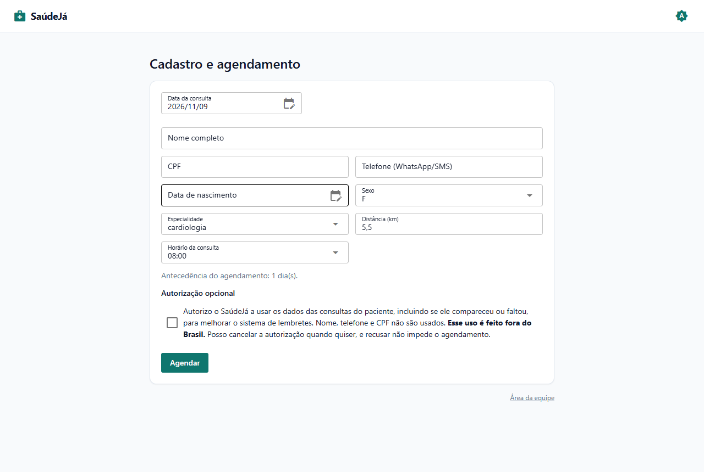
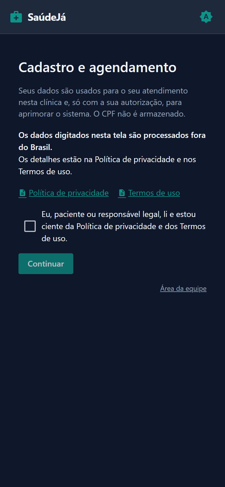
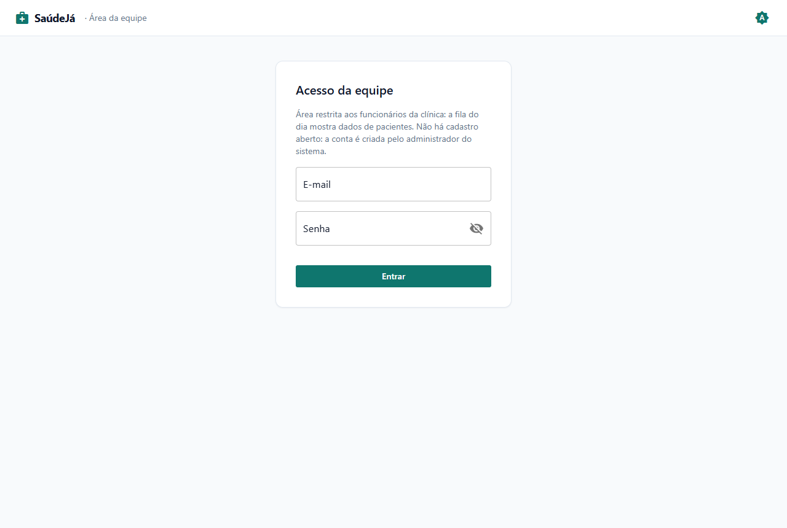
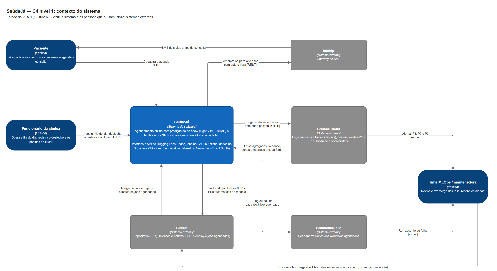
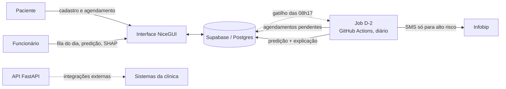

# SaúdeJá — Classificador de no-show em agendamentos médicos

[](https://github.com/VL-in/ai-factory-saudeja/actions/workflows/deploy.yml)
[](https://github.com/VL-in/ai-factory-saudeja/releases)
[](https://www.python.org/downloads/release/python-3100/)
[](https://vl-in-saudeja-prod.hf.space)
[](LICENSE)

Prevê quais pacientes têm alta probabilidade de faltar a uma consulta e envia lembrete por SMS só para eles, dois dias antes do atendimento.

**Demonstração:** <https://vl-in-saudeja-prod.hf.space> · **Painéis ao vivo:** [Grafana Cloud, sem login](#painéis-públicos) · **Histórico de versões:** [CHANGELOG](docs/logs/CHANGELOG.md)

## Sumário

- [Visão geral](#visão-geral)
- [Capturas de tela](#capturas-de-tela)
- [Arquitetura](#arquitetura)
- [Stack](#stack)
- [Como rodar](#como-rodar)
- [Testes e contribuição](#testes-e-contribuição)
- [Troubleshooting](#troubleshooting)
- [Limitações conhecidas](#limitações-conhecidas)
- [Dados pessoais e LGPD](#dados-pessoais-e-lgpd)
- [Operação em produção](#operação-em-produção)
- [Documentação](#documentação)
- [Autoria e licença](#autoria-e-licença)

## Visão geral

O SaúdeJá é um SaaS (fictício) para clínicas particulares de pequeno e médio porte, com agendamento online, prontuário, faturamento e comunicação com pacientes. Este repositório desenvolve a funcionalidade que prevê quais pacientes vão faltar à consulta, com um classificador LightGBM e a explicação SHAP de cada previsão.

### Problema

O no-show custa em média **R$ 180 por consulta perdida**, e a taxa nacional gira em torno de 25-35%. Para uma clínica média (1.500 consultas/mês), isso significa R$ 70k-100k de receita perdida todo mês. Mandar lembrete a todos os pacientes sai caro demais para clínicas com orçamento menor. A proposta classifica os pacientes com alta chance de não comparecer e manda lembrete só para eles, reduzindo em até 70% o gasto com mensageria.

### O que o sistema faz

- **Autoagendamento:** o paciente se cadastra pelo CPF e marca a consulta na interface web.
- **Predição D-2:** todo dia, um job calcula o risco de falta das consultas dos próximos dois dias e grava a explicação de cada uma.
- **Lembrete seletivo:** só quem passa do limite de risco recebe SMS, apenas com data e hora da consulta.
- **Fila do dia:** a equipe da clínica vê os pacientes ordenados por risco, com a explicação, registra quem compareceu e atende os pedidos de titular da LGPD.
- **Ciclo de vida do modelo:** re-treino mensal com os desfechos registrados pela clínica, gate de promoção, canário com 20% da fila e rollback.
- **Observabilidade:** logs, métricas e traces no Grafana Cloud, sem dado pessoal, com alertas por criticidade e sonda de disponibilidade.

### Desempenho do modelo

Medido no fold de teste isolado, o modelo em produção tem **acurácia de 0,67, F1-score de 0,42 para a classe positiva e ROC-AUC de 0,64** ([`data/champion_metrics.json`](data/champion_metrics.json)). O protótipo herdado reportava acurácia de 78%, F1 de 0,65 e ROC-AUC de 0,81; reproduzido, o F1 real da classe positiva era 0,235 ([ADR-003](docs/adr/adr-003-SMOTE-NC.md)). Ver [Limitações conhecidas](#limitações-conhecidas).

## Capturas de tela

| Agendamento do paciente | Celular, tema escuro | Acesso da equipe |
|---|---|---|
|  |  |  |

A entrada (`/`) mostra a frase "Feito para o seu bem-estar" sobre uma foto esmaecida e dois acessos: "Sou paciente" leva ao agendamento (`/paciente`, sem login) e "Sou funcionário" à área da equipe (`/equipe`). Antes de qualquer campo, o paciente declara ciência da Política de privacidade e dos Termos de uso; o formulário só é montado depois disso. A área da equipe (`/equipe`) tem as abas "Fila do dia", "Pedidos do titular" e "Time técnico".

## Arquitetura



Diagramas C4 de contexto e de containers, com a descrição de cada fluxo, em [`docs/architecture.md`](docs/architecture.md#2-high-level-system-diagram) (PNG editável no draw.io: [C1](docs/diagrams/SaudeJa-C1.drawio.png), [C2](docs/diagrams/SaudeJa-C2.drawio.png)). As decisões e alternativas descartadas estão em [`docs/adr/`](docs/adr/).

### Fluxo do produto



1. O paciente se cadastra e agenda a consulta pela interface. Os dados vão para o Supabase.
2. Todo dia às 08h17 (horário de São Paulo), o Supabase dispara o job D-2 no GitHub Actions (`pg_cron`); o cron do próprio GitHub fica de reserva. O job busca os agendamentos dos próximos dois dias ainda sem predição, calcula a probabilidade de no-show e grava o resultado com a explicação SHAP. Rodar duas vezes no mesmo dia não manda SMS em dobro.
3. Pacientes acima do threshold (`decision.threshold` em [`params.yaml`](params.yaml)) recebem SMS via Infobip, só com data e hora da consulta. Toda decisão, enviada ou não, fica registrada para auditoria por 90 dias.
4. A equipe consulta a "Fila do dia", ordenada pelo risco da avaliação mais recente, com a explicação de cada paciente.

### Componentes

| Componente | Onde está | Função |
|---|---|---|
| Interface | [`src/web/`](src/web/), [`src/ui/logic.py`](src/ui/logic.py) | NiceGUI na porta 7860: início em `/` (escolha entre paciente e equipe), paciente em `/paciente`, Política e Termos em `/privacidade` e `/termos`, equipe em `/equipe` (login via Supabase Auth). A regra de negócio fica em `logic.py`, testável sem framework de interface ([ADR-013](docs/adr/adr-013-interface-nicegui.md)) |
| API de predição | [`src/api/`](src/api/) | FastAPI com `/health` e `/predict` (probabilidade + explicação SHAP), para integrações. Não é exposta no Space |
| Inferência | [`src/inference.py`](src/inference.py), [`src/explain.py`](src/explain.py) | Núcleo de predição e explicabilidade, compartilhado por interface, API e job |
| Contrato de features | [`src/contrato_features.py`](src/contrato_features.py) | Barra dado fora da regra de negócio (quarentena) e marca dado fora do domínio do treino |
| Job D-2 | [`src/jobs/inferencia_diaria.py`](src/jobs/inferencia_diaria.py) | Predição em lote e disparo de lembretes |
| Mensageria | [`src/messaging/`](src/messaging/) | `StubMessagingClient` (padrão, sem rede) ou `InfobipClient` (SMS real) |
| Banco | [`src/db/`](src/db/), [`supabase/migrations/`](supabase/migrations/) | Supabase em São Paulo: banco da clínica (`public`), base de treino (`treino`, só por RPC) e agregados para o Grafana (`observabilidade`). RLS em todas as tabelas |
| LGPD | [`src/id_paciente.py`](src/id_paciente.py), [`src/pseudonimo.py`](src/pseudonimo.py), [`src/consentimento.py`](src/consentimento.py), [`src/lgpd_purga.py`](src/lgpd_purga.py) | Identificador do paciente com HMAC, pseudônimos da base de treino, consentimento e purga diária |
| Observabilidade | [`src/observabilidade.py`](src/observabilidade.py), [`src/telemetria.py`](src/telemetria.py), [`infra/grafana/`](infra/grafana/) | Eventos em `eventos_app` e telemetria OpenTelemetry para o Grafana Cloud; alertas e painéis como código |
| Pipeline de treino | [`dvc.yaml`](dvc.yaml) | DVC + MLflow: `validate_data` → `preprocess` → `train` (SMOTE-NC só no fold de treino + LightGBM) → `validate`, cada stage em container Docker |

A interface chama o modelo **em processo**, sem passar pela API (`PREDICT_BACKEND=processo`, [ADR-005](docs/adr/adr-005-integracoes-implicitas.md)).

### Ambientes e CI/CD

| Ambiente | Branch | Endereço |
|---|---|---|
| Produção | `main` | <https://vl-in-saudeja-prod.hf.space> |
| Desenvolvimento | `dev` | <https://vl-in-saudeja-dev.hf.space> (uso interno) |

Cada ambiente tem Space, projeto Supabase e secrets próprios. O Space publica só a interface (porta 7860); a API roda no mesmo container, sem exposição pública.

| Workflow | Gatilho | Função |
|---|---|---|
| `ci.yml` | PR para `dev`/`main` | `ruff`, `mypy`, `pytest`, build e smoke da imagem, testes de integração; em PR para `main`, versão nova no CHANGELOG |
| `deploy.yml` | push em `dev` ou `main` | Confere o modelo campeão, aplica as migrations e sincroniza o Space; em `main`, cria a tag `vX.Y.Z` e a Release |
| `job_d2.yml` | diário, 08h17 | Inferência D-2 e lembretes |
| `retrain.yml` | dia 1 de cada mês | Re-treino com gate de promoção; abre PR do modelo desafiante |
| `canario.yml` | diário, 09h47 | Avalia o canário e abre PR de promoção ou reversão ([ADR-008](docs/adr/adr-008-canario-do-modelo.md)) |
| `alerta_observabilidade.yml` | diário, 10h17 | Falha quando um limite do SLO é violado nas últimas 24h |
| `lgpd.yml` | diário, 10h37 | Purga LGPD: pedidos do titular e retenção de 90 dias ([ADR-009](docs/adr/adr-009-tratamentos-lgpd-centralizados.md)) |
| `grafana.yml` | fim do deploy em `main`; manual | Aplica regras de alerta e painéis do Grafana |
| `dependency-review.yml` | PR | Bloqueia dependência vulnerável |

Só o modelo campeão vai para produção: deploy e job D-2 conferem o hash do `model.pkl` e o threshold contra `data/champion_metrics.json`.

## Stack

| Camada | Tecnologia | Por quê |
|---|---|---|
| Linguagem | Python 3.10 | [ADR-001](docs/adr/adr-001-stack.md) |
| Modelo | LightGBM 4.5, imbalanced-learn (SMOTE-NC), scikit-learn | [ADR-003](docs/adr/adr-003-SMOTE-NC.md) |
| Explicabilidade | SHAP | Explicação por paciente na fila e na API |
| Versionamento de dados e experimentos | DVC (remote no Azure Blob Storage, Brazil South), MLflow | [ADR-002](docs/adr/adr-002-versionamento.md) |
| Interface | NiceGUI 3.2 | [ADR-013](docs/adr/adr-013-interface-nicegui.md) |
| API | FastAPI + Uvicorn | [ADR-005](docs/adr/adr-005-integracoes-implicitas.md) |
| Banco e autenticação | Supabase (Postgres, Auth, `pg_cron`) | [ADR-010](docs/adr/adr-010-base-de-treino-separada.md) |
| SMS | Infobip | Processamento no Brasil |
| Hospedagem | Hugging Face Spaces (Docker) | |
| CI/CD e jobs agendados | GitHub Actions | |
| Observabilidade | OpenTelemetry, Grafana Cloud (Loki, Prometheus, Tempo, Synthetic Monitoring), Healthchecks.io | [ADR-006](docs/adr/adr-006-observabilidade.md), [ADR-012](docs/adr/adr-012-observabilidade-grafana-cloud-opentelemetry.md) |
| Qualidade | ruff, mypy, pytest | |

As versões exatas estão em [`requirements/`](requirements/).

## Como rodar

Os comandos usam PowerShell e partem da raiz do repositório.

### Pré-requisitos

- Python 3.10
- Docker com Docker Compose
- [Supabase CLI](https://supabase.com/docs/guides/cli) (banco local e testes de integração)
- Acesso ao remote do DVC (URL e connection string do Azure, fornecidas pela mantenedora)

### 1. Clonar e instalar

```powershell
git clone https://github.com/VL-in/ai-factory-saudeja.git
cd ai-factory-saudeja
python -m venv .venv
.venv\Scripts\Activate.ps1
pip install -r requirements/dev.txt
Copy-Item .env.example .env
```

`requirements/dev.txt` reúne todas as camadas (treino, API, interface, DVC, lint); as imagens Docker instalam só o que usam. Preencha o `.env` conforme os comentários de [`.env.example`](.env.example).

### 2. Baixar dataset e modelo (DVC)

A URL do remote não é versionada. Configure-a localmente uma vez e use a **SAS de leitura** como credencial, nunca a chave da conta. O `dvc` lê a credencial do ambiente da sessão, não do `.env`:

```powershell
dvc remote add --local -f azure $env:DVC_REMOTE_URL
Get-Content .env | Where-Object { $_ -match '^AZURE_STORAGE_CONNECTION_STRING=' } |
  ForEach-Object { $env:AZURE_STORAGE_CONNECTION_STRING = $_.Split('=', 2)[1] }
dvc pull
```

A cópia local do dataset segue a retenção do remote ([`LGPD.md` §5.1](docs/LGPD/LGPD.md)): rode `python scripts/purgar_dvc_local.py` depois de cada `git pull` e pelo menos uma vez por semana (`--dry-run` mostra o que sairia).

### 3. Preparar o banco

Banco local:

```powershell
supabase start    # sobe Postgres + Studio via Docker e aplica supabase/migrations/
supabase status   # mostra a URL e a chave secreta para o .env
```

No `.env`, defina:

| Variável | Obrigatória | Para quê |
|---|---|---|
| `SUPABASE_URL`, `SUPABASE_SECRET_KEY` | sim | Acesso ao banco. A chave é a `sb_secret_...`, nunca a `publishable` |
| `PACIENTE_CHAVE_IDENTIFICADOR` | sim, para cadastrar | Chave do HMAC do CPF ([ADR-011](docs/adr/adr-011-identificador-do-paciente-com-chave.md)) |
| `TREINO_CHAVE_PSEUDONIMO` | não | Pseudônimo da base de treino; diferente da anterior. Sem ela, o agendamento funciona e só a base de treino deixa de receber dados |

### 4. Subir a aplicação

Com Docker, do mesmo jeito que roda em produção:

```powershell
docker compose up -d app
```

Sem Docker, em dois terminais:

```powershell
python -m uvicorn api.main:app --reload --app-dir src                        # API
python -m uvicorn web.main:criar_app --factory --app-dir src --port 7860     # interface
```

| Endereço | Serviço |
|---|---|
| <http://localhost:7860> | Interface (tela inicial; paciente em `/paciente`, equipe em `/equipe`) |
| <http://localhost:7860/healthz> | Saúde da interface (`ok`) |
| <http://localhost:8000/health> | Status da API e versão do modelo |
| <http://localhost:8000/docs> | Documentação OpenAPI |

Variáveis de comportamento:

| Variável | Efeito |
|---|---|
| `APP_ENV` | `dev` exibe "Time técnico → Dev: disparo manual", que roda o job D-2 pela interface e mostra o diagnóstico. Sem a variável, vale `prod` |
| `PREDICT_BACKEND` | `processo` (padrão) ou `api` |
| `MESSAGING_PROVIDER` | `stub` (padrão, não envia nada) ou `infobip` (SMS real) |
| `TIMEZONE_CLINICA` | Fuso das datas e da fila do dia (padrão `America/Sao_Paulo`) |
| `OTEL_EXPORTER_OTLP_ENDPOINT` | Liga o envio de telemetria ao Grafana Cloud. Sem ela, nada sai do processo |

### 5. Criar uma conta de funcionário

Não há cadastro aberto. O administrador cria cada conta no projeto Supabase para onde o `.env` aponta (a senha é digitada sem eco):

```powershell
python scripts/criar_funcionario.py recepcao@clinica.com.br
```

No projeto remoto, desligue "Allow new users to sign up" e defina "Minimum password length" como 8 em *Authentication → Sign In / Providers → Email*. O `supabase/config.toml` só vale para o banco local.

### Pedir uma predição à API

```powershell
curl -X POST http://127.0.0.1:8000/predict -H "Content-Type: application/json" -d "{\"idade\":45,\"sexo\":\"F\",\"especialidade\":\"cardiologia\",\"distancia_km\":5.5,\"dias_entre_agendamento_consulta\":14,\"historico_noshow\":1,\"data_hora_agendada\":\"2026-01-09T18:00:00\"}"
```

Resposta com o modelo campeão `6430cb3315da`, resumida:

```json
{
  "probabilidade": 0.482,
  "classe_prevista": 0,
  "threshold_usado": 0.6,
  "explicacao": [
    {"feature": "dias_entre_agendamento_consulta", "contribuicao": -0.523},
    {"feature": "dia_de_semana", "contribuicao": 0.459},
    {"feature": "horario", "contribuicao": 0.416},
    "..."
  ],
  "explicacao_texto": null,
  "model_version": "6430cb3315da",
  "fora_do_dominio": false,
  "campos_fora_do_dominio": []
}
```

A probabilidade fica abaixo do threshold, então esse paciente não receberia lembrete. Cada item da explicação é a contribuição SHAP de uma feature, ordenada pelo valor absoluto: positiva puxa o risco para cima, negativa para baixo.

A rota aplica o mesmo contrato de features do job D-2. Um dado fora da regra de negócio (idade acima de 120, distância acima de 500 km, antecedência acima de 180 dias, horário fora da grade da clínica) volta como 422, com o campo e a regra, sem o valor. Um dado que o modelo não viu no treino é predito e marcado em `fora_do_dominio`, com os campos em `campos_fora_do_dominio`.

### Treinar o modelo

```powershell
docker compose up -d mlflow-server   # MLflow em http://localhost:5000
dvc exp run                          # roda o pipeline como experimento
dvc exp show                         # compara experimentos
```

| Comando | Quando usar |
|---|---|
| `dvc exp run` | Testar variações (ex.: hiperparâmetros em `params.yaml`) sem alterar o `dvc.lock` |
| `dvc exp apply <exp>` | Trazer um experimento escolhido para o workspace |
| `dvc repro` | Consolidar uma mudança definitiva; atualiza `dvc.lock` e `data/model.pkl` |

Ao mudar o dataset, rode `dvc add data/<arquivo>` (nunca `dvc add .`), faça commit do código junto com `dvc.lock` e o `.dvc` correspondente, e envie os artefatos com `dvc push`. Em produção, o modelo não é trocado manualmente: o `retrain.yml` treina, compara com o campeão e abre um PR ([Operação](docs/OPERACAO.md#ciclo-de-vida-do-modelo)).

### Rodar o job D-2 manualmente

```powershell
python src/jobs/inferencia_diaria.py
```

Com `MESSAGING_PROVIDER=stub`, nenhum SMS é enviado.

## Testes e contribuição

```powershell
ruff check src tests scripts   # regras em ruff.toml
mypy src scripts               # configuração em mypy.ini
pytest                         # testes unitários
pytest -m integracao           # exige supabase start e Docker
```

O CI roda exatamente esses comandos.

Fluxo de uma mudança de código:

1. Abra um branch a partir de `dev` e um PR para `dev`. O CI roda lint, tipos, testes e o smoke da imagem.
2. O merge em `dev` faz o deploy no ambiente de dev. Teste ali.
3. Para publicar, abra o PR `dev` → `main` e renomeie `## [Não publicado]` no [CHANGELOG](docs/logs/CHANGELOG.md) para a versão nova (`## [vX.Y.Z]`). O CI confere a versão.
4. O merge em `main` faz o deploy de produção e cria a tag e a Release.

Mudanças só em `docs/**` e no `README.md` não disparam deploy.

Convenções:

- **Commits:** `(tipo) arquivos alterados: o que mudou e por quê`, com `tipo` entre `feat`, `fix`, `perf`, `docs`, `test` e afins.
- **CHANGELOG:** toda mudança visível para quem usa o sistema entra em `## [Não publicado]`, no formato [Keep a Changelog](https://keepachangelog.com/pt-BR/1.1.0/).
- **ADR:** decisão de arquitetura com alternativas descartadas ganha um registro em [`docs/adr/`](docs/adr/), a partir do [modelo](docs/adr/adr-template.md).

## Troubleshooting

### Instalação e DVC

| Sintoma | Causa | Solução |
|---|---|---|
| `.venv\Scripts\Activate.ps1 cannot be loaded because running scripts is disabled` | Política de execução do PowerShell | `Set-ExecutionPolicy -Scope CurrentUser RemoteSigned` |
| `azure is supported, but requires 'dvc-azure'` | Dependências do DVC ausentes no venv | `pip install -r requirements/dvc.txt` |
| `dvc pull` diz que o remote `azure` não existe | O remote é configurado só localmente | `dvc remote add --local -f azure $env:DVC_REMOTE_URL` |
| `requires either account_name or connection_string` | `AZURE_STORAGE_CONNECTION_STRING` não está na sessão (o `dvc` não lê o `.env`) | Rode o bloco do [passo 2](#2-baixar-dataset-e-modelo-dvc) na mesma sessão |
| `AuthenticationFailed`, `sp is mandatory` | A variável recebeu a "URL do SAS" do portal | Use o formato `BlobEndpoint=https://<conta>.blob.core.windows.net/;SharedAccessSignature=sp=...` |
| `AuthenticationFailed`, `Signature did not match` | SAS gerada em outra conta, ou chave rotacionada | Peça uma SAS nova à mantenedora |

### Rodar localmente

| Sintoma | Causa | Solução |
|---|---|---|
| `docker compose build` falha em `COPY data/model.pkl` | A imagem empacota o modelo, que vem do DVC | Rode `dvc pull` antes do build; rebuilde sempre que o modelo mudar |
| `supabase start` falha | Docker parado | Inicie o Docker Desktop e tente de novo |
| `address already in use` na 7860 ou na 8000 | Outro processo (ou o container `app`) na porta | `docker compose down`, ou suba com outra `--port` |
| A linha de partida do `uvicorn` mostra `http://<REDIGIDO>` | Esperado: o filtro de log redige qualquer endereço IP | Acesse `http://localhost:7860` ou `:8000` normalmente |
| A tela diz "Não foi possível cadastrar agora" | Falta `PACIENTE_CHAVE_IDENTIFICADOR`, ou o banco está inacessível | Confira o `.env`; o motivo exato aparece no log do processo |
| A tela da equipe pede para "avisar a equipe técnica" | Configuração do banco ausente ou migration não aplicada | `supabase db reset` (local) ou `supabase db push` (remoto); detalhe em "Time técnico" e no log |
| Login da equipe recusado com credenciais certas | A conta foi criada em outro projeto Supabase | Rode `criar_funcionario.py` com o `.env` apontando para o projeto da interface |
| A aba "Dev: disparo manual" não aparece | `APP_ENV` diferente de `dev` (sem a variável, vale `prod`) | `APP_ENV=dev` no `.env` e reinicie a interface |
| Nada chega ao Grafana Cloud | `OTEL_EXPORTER_OTLP_ENDPOINT` vazio ou `OBSERVABILIDADE_ATIVA=false` | Preencha o endpoint e os headers conforme o `.env.example` |
| A sessão da equipe volta ao login sozinha | Sessão expira após 30 minutos sem uso | Entre de novo |

### Modelo, job e deploy

| Sintoma | Causa | Solução |
|---|---|---|
| Job D-2 ou deploy recusa o modelo | O `model.pkl` ou o `decision.threshold` não batem com `data/champion_metrics.json` | `dvc pull` para baixar o campeão; não altere o threshold sem uma promoção |
| Paciente agendado não aparece com risco na fila | O job ainda não rodou para a data, ou o agendamento caiu em quarentena (dado fora da regra de negócio) | Aguarde o job das 08h17 ou rode-o manualmente; a quarentena aparece no painel "Job D-2" |
| `retrain.yml` termina com código 1, 2, 3 ou 4 | Gate bloqueou, sem dado novo, pipeline falhou ou canário em observação | Ver [Operação → Ciclo de vida do modelo](docs/OPERACAO.md#ciclo-de-vida-do-modelo) |
| CI do PR para `main` falha na versão | `## [Não publicado]` não foi renomeado, ou a versão já tem tag | Use uma versão SemVer nova no topo do CHANGELOG |
| PR `dev` → `main` com conflito no CHANGELOG | Faltou o back-merge depois de um PR automático em `main` | `gh pr create --base dev --head main` e mantenha as duas seções no conflito |
| Validar workflows localmente | | `docker run --rm -v "${PWD}:/repo" -w /repo rhysd/actionlint:latest` |

## Limitações conhecidas

- **Desempenho do modelo abaixo da meta.** Recall e F1 da classe positiva ficam abaixo dos alvos do [SLO](docs/SLO.md) por limite do dataset; a exceção está documentada no SLO (§3), com decisão prevista entre recalibrar o threshold ou aceitar o gap.
- **Dados sintéticos.** A clínica é fictícia e a semente do dataset é sintética ([`data/AVISO-DADOS-SINTETICOS.md`](data/AVISO-DADOS-SINTETICOS.md)). O desempenho em dados reais é desconhecido.
- **LGPD sem validação jurídica.** Política de privacidade, Termos de uso e a caixa de consentimento do treino ainda não foram revisados por profissional do direito.
- **Premissa de operação não cumprida no protótipo.** A transferência internacional se apoia em contas pagas com as cláusulas-padrão da ANPD assinadas; as contas atuais (planos gratuitos, estudante e teste) não têm esse aditivo.
- **Infraestrutura em planos gratuitos.** O banco não tem backup (plano gratuito do Supabase), e o Space roda nos Estados Unidos.
- **Alertas parcialmente testados.** Das 17 regras do Grafana, só a de dado pessoal no Loki teve teste de ponta a ponta (em dev).
- **Funcionalidades pendentes.** O registro da oposição ao lembrete (paciente que pede para não receber SMS) não está implementado, e `explicacao_texto` da API fica `null` até a explicação em linguagem natural ser ativada.

## Dados pessoais e LGPD

O sistema é desenhado como se todo dado fosse real: especialidade, status do agendamento e histórico de faltas revelam informação de saúde e são tratados como **dados sensíveis**. A análise completa (papéis, bases legais, retenção, transferência internacional e riscos) está em [`docs/LGPD/LGPD.md`](docs/LGPD/LGPD.md).

Documentos publicados: [Política de privacidade](docs/LGPD/POLITICA-DE-PRIVACIDADE.md) e [Termos de uso](docs/LGPD/TERMOS-DE-USO.md).

**O agendamento não depende de consentimento** ([ADR-010](docs/adr/adr-010-base-de-treino-separada.md)). A única autorização opcional é a do uso dos desfechos no treino: quem recusa é agendado e lembrado do mesmo jeito.

| Destino | Dados | Região |
|---|---|---|
| Supabase (banco e login) | Dados de paciente e contas de funcionário. A base de treino fica num schema separado, sem nome, telefone, CPF nem data de nascimento | Brasil |
| Hugging Face Space | Tudo o que a tela recebe ou exibe | Estados Unidos |
| GitHub Actions (job D-2, re-treino, purga) | Dados da consulta e telefone; nunca nome nem CPF | Fora do Brasil |
| Azure Blob Storage (DVC) | Dataset de treino pseudonimizado e o modelo | Brasil |
| Infobip | Telefone, data e hora da consulta | Brasil |
| Grafana Cloud | Telemetria sem dado pessoal e agregados | Brasil |

Proteções implementadas:

- **CPF não é gravado:** vira um identificador HMAC com chave secreta guardada fora do banco ([ADR-011](docs/adr/adr-011-identificador-do-paciente-com-chave.md)).
- **Nome só na fila do dia:** não vai para log, API, dataset de treino, SMS nem telemetria, com um teste para cada saída ([ADR-007](docs/adr/adr-007-nome-do-paciente.md)).
- **Log sem dado pessoal:** filtro de redação em todos os handlers, também aplicado ao que vai para o Grafana ([`src/logging_config.py`](src/logging_config.py)).
- **SMS sem dado de saúde:** o lembrete só informa data e hora.
- **Base de treino separada:** só recebe quem consentiu, só é acessada por funções do banco e usa pseudônimos com chave secreta.
- **Retenção e purga automáticas:** predições, explicações e registros de lembrete saem em 90 dias; pedidos do titular são executados pelo `lgpd.yml`, inclusive nas versões do dataset no DVC ([procedimento](docs/LGPD/PROCEDIMENTO-ELIMINACAO.md)).
- **Acesso:** RLS em todas as tabelas; área da equipe com login individual e sessão de 30 minutos.
- **Revisão da decisão automatizada:** a única decisão automatizada é enviar ou não o lembrete; o paciente pede explicação ou revisão à clínica ([procedimento](docs/LGPD/PROCEDIMENTO-REVISAO.md)).

## Operação em produção

Pontos de decisão humana, alertas por criticidade, disponibilidade e procedimentos de rollback (canário, campeão e código) estão em [`docs/OPERACAO.md`](docs/OPERACAO.md).

### Painéis públicos

Os seis painéis do Grafana Cloud estão publicados por link, só para leitura e sem login. Eles mostram agregados e logs que já passaram pelo filtro de dados pessoais.

| Painel | O que mostra |
|---|---|
| [Visão geral (SLO)](https://minilasagna354.grafana.net/public-dashboards/4fa820057a864553b9954a5777ea44d6) | Último job D-2, cobertura da explicação, disponibilidade, disparos, custo projetado |
| [Job D-2](https://minilasagna354.grafana.net/public-dashboards/b01849b776db4343af2c00c99cf4e166) | Execuções, duração, agendamentos por resultado, log do job |
| [Inferência ML](https://minilasagna354.grafana.net/public-dashboards/38561056c61249c8b3069d015c57b244) | Latência p50/p95/p99, distribuição da probabilidade, dado fora do domínio |
| [Mensageria (Infobip)](https://minilasagna354.grafana.net/public-dashboards/e4544a72eadc44b5940136fe1a46ebda) | Disparos, status do envio, latência da Infobip |
| [Interface](https://minilasagna354.grafana.net/public-dashboards/3bb196558d9444f4a0747ce8203b70b2) | Ações por minuto, taxa de erro, latência, log da interface |
| [Custo de SMS](https://minilasagna354.grafana.net/public-dashboards/9d56d7fc7cd84b0990b09146e6102882) | Gasto no mês, projeção contra o orçamento |

Na visão pública, o painel de traces do Job D-2 fica vazio, porque o compartilhamento externo da Grafana não suporta o Tempo.

## Documentação

| Documento | Conteúdo |
|---|---|
| [`docs/architecture.md`](docs/architecture.md) | Arquitetura detalhada, diagramas C4 e roadmap técnico |
| [`docs/adr/`](docs/adr/) | Registros de decisão de arquitetura |
| [`docs/OPERACAO.md`](docs/OPERACAO.md) | Operação, alertas e rollback |
| [`docs/SLO.md`](docs/SLO.md), [`docs/SLA.md`](docs/SLA.md) | Metas de serviço |
| [`docs/LGPD/`](docs/LGPD/) | Análise LGPD, política, termos e procedimentos do titular |
| [`docs/logs/CHANGELOG.md`](docs/logs/CHANGELOG.md) | Histórico de versões |
| [`docs/post-mortem/`](docs/post-mortem/), [`docs/rollbacks/`](docs/rollbacks/) | Registros de incidente e de rollback |

## Autoria e licença

Desenvolvido por **Vanessa Hoysan Lin** na disciplina AI Factory: Build, Deploy and Showcase, com apoio do [Claude Code](https://claude.com/claude-code) na implementação e na documentação.

- Repositório-base da disciplina, com o protótipo herdado: [wmonteiro-ai/ai-factory-saudeja](https://github.com/wmonteiro-ai/ai-factory-saudeja), de Wellington R. Monteiro. O notebook e o README originais estão em [`docs/herdado/`](docs/herdado/).

Licença [MIT](LICENSE).
