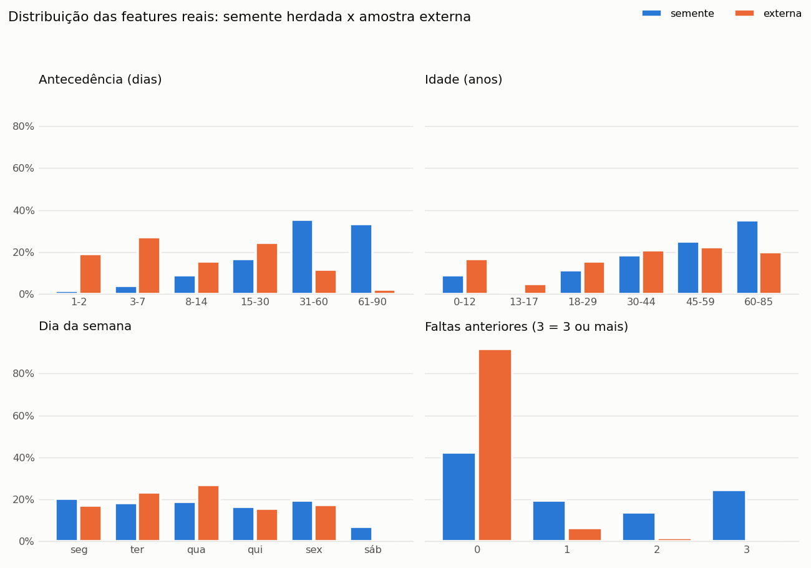
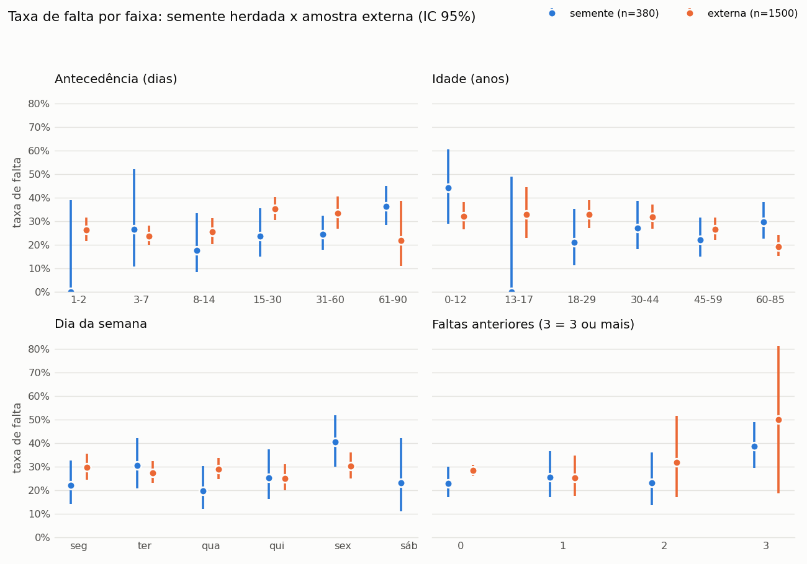

# Análise exploratória: dataset externo × semente herdada

> 2026-11-21. Compara o dataset externo final ([ADR-014](../adr/adr-014-dataset-externo-desfecho-real.md)) com o primeiro dataset de treino do projeto, a semente sintética herdada (`data/consultas-historicas.csv`). Reproduzível com `python scripts/eda_dataset_externo.py --saida docs/analises/img`. Só agregados: nenhuma linha de paciente aparece aqui.

**Dataset externo final** = a amostra de treino `data/externo/consultas-externas.csv` (1.500 consultas). Quando a amostra é pequena demais para uma faixa, o pool adaptado (70.985 consultas, de onde a amostra foi sorteada) serve de referência estável. Os dados externos são de 2016, da rede pública de Vitória-ES, e **não são pacientes do SaúdeJá**. O que se mede aqui é sinal em dado público real, não desempenho do SaúdeJá.

## 1. Visão geral

| | Semente herdada | Amostra externa | Pool externo |
|---|---|---|---|
| Linhas | 380 | 1.500 | 70.985 |
| Pacientes (ids distintos) | 206 | 1.480 | 45.209 |
| Consultas por paciente | 1,84 | 1,01 | 1,57 |
| Ids com idade ou sexo variando | **76** | 0 | 0 |
| Taxa de falta | 27,4% | 28,4% | 28,6% |
| Idade mediana | 51 | 39 | 38 |
| Antecedência mediana (dias) | 44,5 | 9 | 9 |
| `historico_noshow` = 0 | 42,4% | 91,6% | 92,3% |
| `historico_noshow` médio | 1,58 | 0,11 | 0,10 |
| Mulheres | 67,1% | 67,1% | 66,7% |
| Período das consultas | 05 a 10/01/2026 (1 semana) | 29/04 a 08/06/2016 (6 semanas) | idem |

O que salta aos olhos:

- **A prevalência é quase a mesma** (27,4% contra 28,4%). As métricas que dependem da taxa base (pr_auc do acaso, Brier da taxa base) ficam comparáveis.
- **O id de paciente da semente não é uma pessoa.** Em 76 dos 206 ids, a idade ou o sexo mudam entre as consultas. No externo, o pseudônimo é estável (0 inconsistências), e é por isso que a validação por paciente (`StratifiedGroupKFold`) passa a ser obrigatória.
- **A população é outra.** O externo é mais jovem (mediana 38 contra 51 anos) e marca com muito menos antecedência (9 contra 44,5 dias).
- **O histórico externo é truncado** (risco R5 do ADR). O registro começa em 29/04/2016, então 92% das consultas têm `historico_noshow` = 0, contra 42% na semente.

## 2. Distribuição das features

PSI contra a semente (acima de 0,2 é "mudança relevante", a régua do `validate_data`):

| Feature | Amostra | Pool | Leitura |
|---|---|---|---|
| `dias_entre_agendamento_consulta` | 2,19 | 1,97 | populações muito diferentes: a semente quase não tem consulta de 1 a 7 dias |
| `historico_noshow` | 1,54 | 1,47 | histórico truncado no externo (R5) |
| dia da semana | 0,50 | 0,37 | o externo quase não tem sábado (30 em 70.985) |
| `idade` | 0,27 | 0,28 | externo mais jovem, com crianças e adolescentes |
| `sexo` | 0,00 | 0,00 | igual |
| `especialidade` (imputada) | 0,004 | 0,000 | sorteada da semente: igual por construção |
| `distancia_km` (imputada) | 0,014 | 0,000 | idem |
| horário (imputado) | 0,015 | 0,011 | idem |

As três features imputadas ficam com PSI perto de zero, como o contrato exige (≤ 0,1). A origem da linha **não** pode ser descoberta pelo formato dessas colunas. As quatro features reais mudam de verdade: é o "domínio diferente" (R2) medido.

## 3. Taxa de falta por faixa

Pontos com intervalo de 95% (Wilson). A semente tem faixas com 4 a 15 linhas, daí os intervalos enormes.

| Faixa | Semente | Amostra | Pool (referência) |
|---|---|---|---|
| Antecedência 1-2 dias | 0% (n=6) | 26,2% | 22,7% |
| 3-7 | 26,7% (n=15) | 23,8% | 25,0% |
| 8-14 | 17,6% | 25,4% | 30,5% |
| 15-30 | 23,8% | 35,3% | 32,7% |
| 31-60 | 24,4% | 33,3% | 34,2% |
| 61-90 | 36,2% | 21,9% (n=32) | 29,0% |
| Idade 0-12 | 44,1% | 32,1% | 30,9% |
| 13-17 | 0% (n=4) | 32,9% | 36,6% |
| 18-29 | 20,9% | 32,8% | 35,4% |
| 30-44 | 27,1% | 31,9% | 31,5% |
| 45-59 | 22,1% | 26,7% | 24,7% |
| 60-85 | 29,8% | 19,3% | 20,3% |
| Faltas anteriores 0 | 23,0% | 28,5% | 28,5% |
| 1 | 25,7% | 25,3% | 28,7% |
| 2 | 23,1% | 32,0% (n=25) | 32,0% |
| 3 ou mais | 38,7% | 50,0% (n=6) | 36,0% |

O que o dado real mostra e a semente não mostrava:

- **Idade é o sinal mais claro do externo, e ao contrário do que a semente sugere:** quem tem 60 anos ou mais falta menos (20%) que adolescentes e jovens adultos (35% a 37%). Na semente, os idosos faltavam mais que a média.
- **Antecedência tem efeito em U invertido:** a falta sobe de 23% (1-2 dias) para 34% (31-60 dias) e cai de novo em 61-90. A semente só via o aumento no fim.
- **O histórico só separa a partir de 2 faltas** (32% e 36%, contra 28,5% de quem não tem nenhuma), e com volume pequeno, por causa do truncamento.

## 4. O padrão "sexta, 17h-18h"

| | Semente | Pool externo |
|---|---|---|
| Falta na sexta | 40,5% | 29,5% |
| Falta nos outros dias | 24,2% | 28,4% |
| Falta na sexta, 17h-18h | **61,5%** (n=26) | 30,3% (n=3.178) |
| Falta no resto | 24,9% | 28,5% |

**A metade "sexta" é testável e não se confirma:** no dado real, a sexta falta 1,1 ponto acima dos outros dias, contra 16 pontos na semente. **A metade "17h-18h" não é testável:** o Kaggle não tem a hora da consulta, e o horário externo foi sorteado da semente sem olhar o desfecho, então os 30,3% são, por construção, a taxa base. O recorte forte da semente continua sendo o que o diagnóstico do modelo já dizia: um padrão injetado pelo script de timestamp sintético.

## 5. SMS e antecedência (risco R6)

No pool, quem recebeu SMS falta 27,7%, e quem não recebeu, 29,5%: uma diferença pequena. Separando por antecedência, o quadro muda:

| Antecedência | SMS enviado | Falta com SMS | Falta sem SMS |
|---|---|---|---|
| 1-2 dias | 0% | — | 22,7% |
| 3-7 | 57,2% | 23,8% | 26,6% |
| 8-14 | 58,3% | 28,2% | 33,8% |
| 15-30 | 60,7% | 29,8% | 37,0% |
| 31-60 | 61,2% | 31,6% | 38,3% |
| 61-90 | 64,4% | 25,5% | 35,3% |

Dentro de cada faixa, quem recebeu SMS falta de 3 a 10 pontos a menos. No agregado, a diferença quase some, porque quem marca com antecedência longa recebe mais SMS **e** falta mais. É o confundimento que o ADR previa. Isso **não** calibra a eficácia do lembrete do SaúdeJá (outro canal, outra época, outra rede), mas mostra por que a análise do lembrete (Etapa 6) só faz sentido estratificada.

## 6. Achado sobre a amostra de 1.500

Na amostra oficial, as mulheres faltam 30,1% e os homens, 24,9%. No pool de onde ela saiu, a diferença não existe (28,5% contra 28,7%). É variação de amostragem, exatamente o risco R11: uma amostra de 1.500 pode ter padrões que a população não tem. Foi por isso que o teste de sinal foi pré-registrado com mais duas sementes de amostra.

## 7. Consequências para o modelo

1. **O dado externo não "conserta" a semente; ele a contradiz em três pontos:** idade (sinal invertido), antecedência (efeito em U, não monotônico) e sexta-feira (sem efeito). Um modelo treinado na semente aprende relações que o dado real não confirma.
2. **As features imputadas não carregam sinal nem denunciam a origem** (PSI ≈ 0). Nas linhas externas, elas são ruído, como previsto.
3. **`historico_noshow` perde quase todo o poder no externo** por truncamento, não necessariamente por ser uma feature fraca. O efeito dela não deve ser comparado entre origens (ADR-014).
4. **A população externa é mais parecida com a do job D-2 em antecedência curta.** A semente quase não tem consulta de 1 a 7 dias (5,5% das linhas, contra 46% no externo), e é justamente aí que o lembrete D-2 atua.
