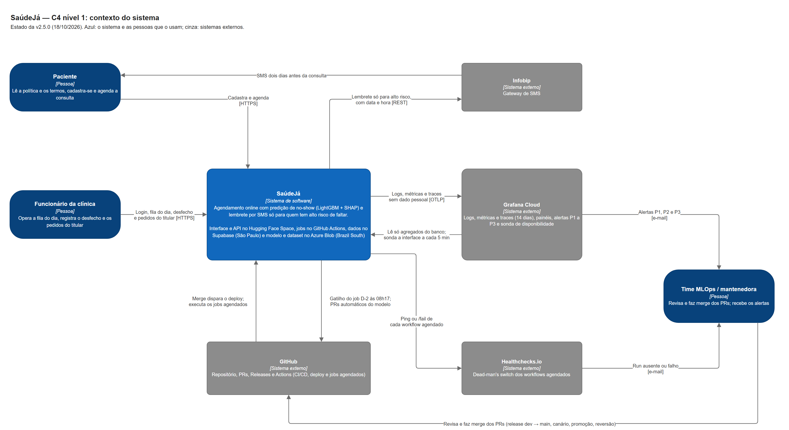
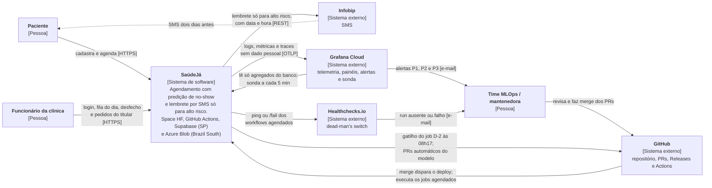
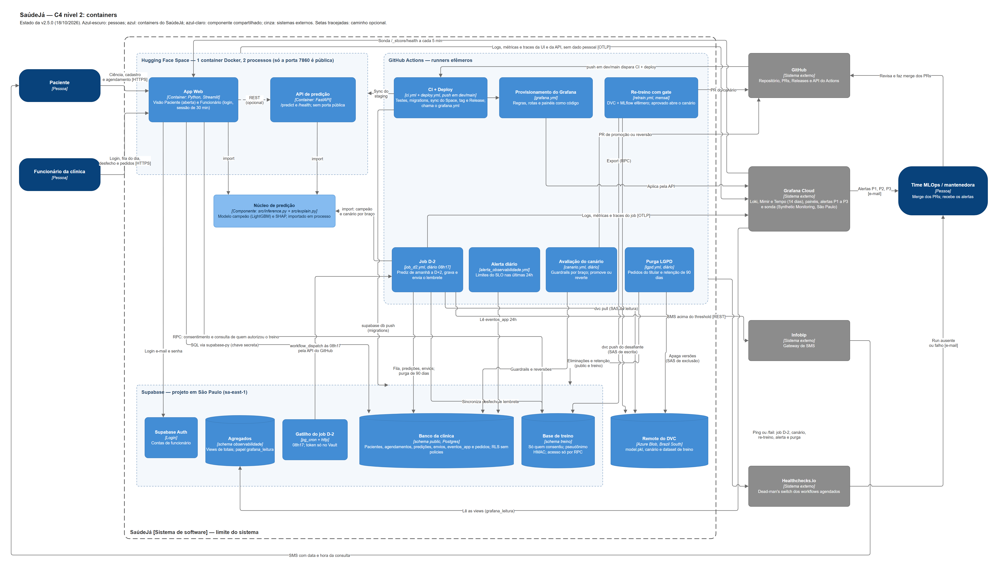

# Architecture Overview
This document serves as a critical, living template designed to equip agents with a rapid and comprehensive understanding of the codebase's architecture, enabling efficient navigation and effective contribution from day one. Update this document as the codebase evolves.

## 1. Project Structure

```
ai-factory-saudeja/
├── data/
│   ├── consultas-historicas.csv       # versionado via DVC (não versionado no git)
│   ├── consultas-historicas.csv.dvc   # metadados do DVC
│   ├── interim/                       # artefatos intermediários do pipeline (dados_validados.json, relatorio_dados.json, train_raw.pkl, test.pkl, mapa_especialidade.json, mlflow_run_id.txt)
│   ├── model.pkl                      # modelo treinado (saída do stage train)
│   ├── consultas-treino.csv           # semente + desfechos reais de produção (via DVC)
│   ├── champion_metrics.json          # métricas do modelo em produção (versionado em git)
│   ├── canario.json / canario/        # canário em observação, só enquanto ativo (ADR-008)
│   ├── canario_historico.json         # canários encerrados: promovidos e revertidos
│   ├── AVISO-DADOS-SINTETICOS.md
│   └── AVISO-MODELO.md
├── docs/
│   ├── BRIEFING.md
│   ├── LGPD/                          # LGPD.md (base legal, retenção, direitos, riscos), política de privacidade, termos de uso e procedimentos de revisão e eliminação
│   ├── SLA.md
│   ├── SLO.md
│   ├── adr/                           # Architecture Decision Records (ADR-001 a ADR-012)
│   ├── diagrams/
│   │   ├── SaudeJa-C1.drawio.png      # diagrama C4 nível 1 (contexto), seção 2; PNG com o XML do draw.io embutido
│   │   └── SaudeJa-C2.drawio.png      # diagrama C4 nível 2 (containers), seção 2; idem
│   ├── herdado/                       # documentação do protótipo herdado
│   ├── logs/
│   │   └── CHANGELOG.md
│   ├── post-mortem/                   # PM-001
│   ├── rollbacks/                     # RB-001 (ensaio de rollback em dev)
│   └── architecture.md                # este arquivo
├── infra/
│   ├── api/                            # dockerfile da API FastAPI isolada
│   ├── deploy/                         # dockerfile + entrypoint.sh combinados Streamlit+FastAPI (imagem do HF Space)
│   └── grafana/                        # alertas/*.yaml (17 regras P1-P3), notificacoes.yaml (rotas por criticidade), dashboards/*.json (6 painéis)
├── scripts/
│   ├── auditoria_lgpd.py              # varredura de PII em log (ferramenta local)
│   ├── criar_funcionario.py           # cria a conta de funcionário no Supabase Auth (cadastro aberto desligado)
│   ├── gerar_timestamp_sintetico.py   # geração de timestamp sintético (exploratório)
│   ├── grafana_provisionar.py         # aplica/confere/remove alertas, rotas e painéis do Grafana (grafana.yml)
│   ├── migrar_id_paciente.py          # migração única do id_paciente_externo para HMAC (ADR-011), dry-run por padrão
│   ├── montar_staging_space.py        # lista fechada do que sobe para o Space (CI e deploy)
│   ├── pedido_titular_treino.py       # registra pedido do titular recebido direto pelo encarregado (base de treino)
│   ├── purgar_dvc_local.py            # purga das cópias locais do DVC (LGPD.md §5.1)
│   ├── smoke_deploy.py                # smoke da imagem local e do Space publicado
│   └── versao_release.py              # versão SemVer a partir do CHANGELOG (conferir, subir-patch, notas da Release)
├── supabase/
│   ├── config.toml                    # config do Supabase CLI (supabase start, região local)
│   └── migrations/                    # schema versionado: banco da clínica, eventos_app, canarios_revertidos, pedidos_titular, schema treino, schema observabilidade (views + papel grafana_leitura) e gatilho do job D-2 (pg_cron + http)
├── src/
│   ├── config_projeto.py              # REPO_ROOT + carregar_params(): caminhos independentes do CWD
│   ├── logging_config.py              # log estruturado JSON + redação de PII
│   ├── observabilidade.py             # eventos_app: medir/registrar_evento com allowlist do detalhe (ADR-006)
│   ├── telemetria.py                  # OpenTelemetry -> Grafana Cloud (logs, métricas, traces), no-op sem endpoint
│   ├── alerta_observabilidade.py      # alerta diário sobre as últimas 24h de eventos_app (alerta_observabilidade.yml)
│   ├── saida_actions.py               # saída dos scripts de workflow: terminal, $GITHUB_STEP_SUMMARY, $GITHUB_OUTPUT
│   ├── agenda_clinica.py              # grade de horários da clínica (cadastro do paciente)
│   ├── db/                            # client.py (supabase-py) + repositories.py (banco da clínica) + repositorio_treino.py (schema treino, só RPC)
│   ├── consentimento.py               # regras do consentimento do treino, sem banco (ADR-009, ADR-010)
│   ├── pseudonimo.py                  # pseudônimos HMAC da base de treino (ADR-010)
│   ├── id_paciente.py                 # identificador HMAC do paciente no banco da clínica (ADR-011)
│   ├── documentos_legais.py           # Política de privacidade e Termos de uso exibidos na tela de agendamento
│   ├── lgpd_purga.py                  # workflow de purga LGPD: pedidos do titular e retenção do DVC e da base de treino
│   ├── export_treino.py               # base de treino (schema treino) -> consultas-treino.csv
│   ├── contrato_features.py           # contrato de features: regra de negócio x domínio do treino
│   ├── validate_data.py               # gate de dados do re-treino (stage 0)
│   ├── retrain_gate.py                # gate de promoção do re-treino mensal (regressão relativa, piso e sanidade)
│   ├── sanidade_modelo.py             # suíte de sanidade e casos limítrofes do modelo
│   ├── campeao.py                     # "só o campeão vai para produção": sha + threshold
│   ├── canario.py                     # canário do modelo: divisão da fila, guardrails e rollback
│   ├── preprocess.py                  # feature engineering + split treino/teste (stage 1)
│   ├── train.py                       # SMOTE-NC + treino LightGBM, loga no MLflow (stage 2)
│   ├── validate.py                    # métricas no fold de teste isolado (stage 3)
│   ├── tune.py                        # GridSearchCV de hiperparâmetros (exploratório, fora do dvc.yaml)
│   ├── features.py
│   ├── inference.py                   # payload -> features -> predição, reusado por API/job
│   ├── explain.py                     # explicabilidade SHAP + plug LLM inativo
│   ├── api/                           # API FastAPI: schemas.py + main.py
│   ├── ui/                            # interface Streamlit: app.py (telas) + logic.py (lógica testável)
│   ├── jobs/                          # inferencia_diaria.py: job D-2
│   └── messaging/                     # client.py: interface + stub + InfobipClient (SMS real)
├── tests/                             # testes unitários e de integração do pipeline
├── .github/                          # workflows/: ci.yml, deploy.yml, job_d2.yml, retrain.yml, canario.yml, lgpd.yml, alerta_observabilidade.yml, grafana.yml, dependency-review.yml; dependabot.yml
├── .dvc/                              # configuração e cache do DVC (config versionado só com `core.remote`; URL/credencial fora do git)
├── dvc.yaml / dvc.lock                # definição e lock do pipeline DVC
├── params.yaml                        # hiperparâmetros, threshold, gate, canário, limites de observabilidade e custo do SMS
├── dockerfile / dockerfile.mlflow     # imagens de treino e do servidor MLflow
├── docker-compose.yml                 # orquestração local: app (UI + API), train (stages do DVC) e mlflow-server
├── requirements/                      # base.txt / train.txt / api.txt / ui.txt / dvc.txt / dev.txt
├── pytest.ini                         # marcador `integracao`
├── ruff.toml                          # configuração do lint (inclui as regras S, flake8-bandit)
├── mypy.ini                           # type-check estático em dois níveis
├── .dockerignore / .gitattributes  # contexto de build enxuto; LF nos .sh mesmo no Windows
├── .env.example
└── README.md
```

## 2. High-Level System Diagram

Os dois níveis estão em PNG com o XML do draw.io embutido ([C1](diagrams/SaudeJa-C1.drawio.png), [C2](diagrams/SaudeJa-C2.drawio.png)), que abre editável no [app.diagrams.net](https://app.diagrams.net). O C1 também está em Mermaid, e o C2 tem as relações em tabela. Estado da v2.5.0 (18/10/2026). Ao mudar o PNG, mude o texto junto.

O limite do sistema inclui o que o SaúdeJá opera, mesmo em serviço gerenciado: o Space, os workflows do Actions, o projeto Supabase e o container do Azure guardam código ou dado do sistema. Ficam fora os serviços com que ele só conversa.

### Camada C1



<details>
<summary>Versão em Mermaid</summary>



</details>

### Camada C2



O C2 tem relações demais para o layout automático do Mermaid, que puxa sistemas externos para dentro do limite. A fonte dele é o PNG editável acima, e a tabela abaixo traz as mesmas relações em texto, para busca e revisão de diff.

| De | Para | O quê / como |
|---|---|---|
| Paciente | App Web | HTTPS: ciência da política e dos termos, cadastro e agendamento |
| Funcionário da clínica | App Web | HTTPS: login, fila do dia, desfecho e pedidos do titular |
| App Web | Supabase Auth | login com e-mail e senha (o token é revogado logo depois, §7) |
| App Web | Banco da clínica (`public`) | SQL via `supabase-py`, com a chave secreta |
| App Web | Base de treino (`treino`) | RPC `treino_*`: consentimento e consulta de quem autorizou o treino |
| App Web, API | Núcleo de predição | import em processo ([ADR-005](adr/adr-005-integracoes-implicitas.md) b) |
| App Web | API de predição | REST, só com `PREDICT_BACKEND=api` (tracejada) |
| Gatilho do job D-2 (`pg_cron` + `http`) | Job D-2 | `workflow_dispatch` às 08h17 pela API do GitHub; o cron do GitHub fica de reserva |
| Job D-2 | Núcleo de predição | import: campeão e, com canário ativo, o modelo de cada braço |
| Job D-2 | Banco da clínica | fila de amanhã a D+2, predições, envios e purga de 90 dias |
| Job D-2 | Base de treino | sincroniza desfecho e lembrete pelo pseudônimo da consulta |
| Job D-2 | Remote do DVC | `dvc pull` com a SAS de leitura |
| Job D-2 | Infobip → Paciente | SMS acima do threshold do braço, só com data e hora |
| Alerta diário | Banco da clínica | lê `eventos_app` das últimas 24h |
| Avaliação do canário | Banco da clínica | guardrails por braço e `canarios_revertidos` |
| Purga LGPD | Banco da clínica, base de treino | eliminações confirmadas pela clínica, pedidos do titular e retenção |
| Purga LGPD | Remote do DVC | apaga versões expiradas e do titular (SAS de exclusão) |
| Re-treino com gate | Base de treino, remote do DVC | export por RPC; `dvc push` do desafiante (SAS de escrita) |
| Re-treino, canário | GitHub | PR do canário; PR de promoção ou reversão |
| GitHub | CI + Deploy | push em `dev`/`main` dispara CI e deploy |
| CI + Deploy | Space, Supabase, Provisionamento do Grafana | sync do staging com o `model.pkl` do campeão; `supabase db push`; em `main`, `workflow_call` do `grafana.yml` |
| Provisionamento do Grafana | Grafana Cloud | regras, rotas e painéis pela API |
| App Web, API, Job D-2 | Grafana Cloud | logs, métricas e traces sem dado pessoal [OTLP] |
| Grafana Cloud | Agregados (`observabilidade`) | lê as views com o papel `grafana_leitura` |
| Grafana Cloud | App Web | sonda HTTPS em `/_stcore/health` a cada 5 min |
| Grafana Cloud | Time MLOps | alertas P1, P2 e P3 por e-mail |
| Workflows agendados | Healthchecks.io → Time MLOps | ping de sucesso ou `/fail`; run ausente ou falho vira e-mail |
| Time MLOps | GitHub | revisa e faz merge dos PRs |

## 3. Core Components

### 3.1. Frontend

Name: App Web (Streamlit)

Description: Interface única para dois perfis, escolhidos na barra lateral. A visão **Paciente** (aberta, é o autoagendamento) é a tela de entrada. A visão **Funcionário da clínica** fica atrás de login com e-mail e senha no Supabase Auth (ver §7, Authorization) e tem três abas: "Fila do dia" (agendamentos ordenados por risco, com o nome do paciente, [ADR-007](adr/adr-007-nome-do-paciente.md), os três fatores que mais pesaram em português e o registro do desfecho), "Pedidos do titular" e "Time técnico", com as subabas "Observabilidade", "Testar predição", "Explicabilidade" e, só com `APP_ENV=dev`, "Dev: disparo manual", que chama o job D-2 sem a checagem do campeão. Sem `APP_ENV` definido, a interface assume produção e esconde essa subaba. Cada ação da interface (carregar a fila, registrar desfecho, cadastro, pedidos, login) é medida em `eventos_app` como `acao_ui` e vira um trace no Grafana Cloud (§6). A fila é lida numa única requisição ao PostgREST, com o paciente e só a predição mais recente embutidos, e fica em `st.cache_data` por data, com TTL de 60 s e até 7 datas. O `st.tabs` executa todas as abas a cada interação, e sem o cache qualquer clique refazia a consulta. As escritas feitas pela própria tela (desfecho, cadastro, job manual) limpam o cache na hora; o que muda por fora (job D-2, purga LGPD) aparece em até 60 s, que é também o tempo máximo que o nome de um paciente eliminado continua na memória do Space. A medição `carregar_fila` fica dentro do cache, então mede só as idas ao banco. Uma falha do banco na tela do paciente mostra mensagem genérica; o detalhe fica no log e em `eventos_app`. Desde 2026-10-10 ([ADR-010](adr/adr-010-base-de-treino-separada.md)), a tela do paciente começa por uma caixa de **ciência** da Política de privacidade e dos Termos de uso, abertos em telas próprias por link, e um botão "Continuar" que libera o formulário; o agendamento não depende de consentimento, e a única autorização opcional, a do treino, leva a consulta também para a base de treino (§4.1). A visão do funcionário ganhou a aba "Pedidos do titular", onde a clínica registra, confirma ou recusa os pedidos sobre os dados dela e encaminha à SaúdeJá os pedidos sobre os dados de treino.

Separação interna: `src/ui/app.py` é só apresentação; toda a lógica (montagem do payload, tradução de erro para mensagem, escolha do backend) vive em `src/ui/logic.py`, que não importa `streamlit` e é testado sem o runtime dele.

Como obtém a predição: **em processo por padrão** (import direto de `src/inference.py`/`src/explain.py`, conforme [ADR-005](adr/adr-005-integracoes-implicitas.md) (b) — a UI não depende de a API estar de pé nem paga round-trip HTTP dentro do próprio container). O backend REST contra a API (3.2.1) fica disponível em `PREDICT_BACKEND=api` como ferramenta de desenvolvimento/diagnóstico, com teste de paridade automatizado entre os dois caminhos. O LLM (5) é opcional e ainda não está ligado.

Technologies: Python, Streamlit, `httpx` (só no backend REST opcional)

Deployment: mesmo container do Hugging Face Space da API (ver 6), processo único, sem hospedagem separada.

### 3.2. Backend Services

#### 3.2.1. API de predição (FastAPI)

Name: API de predição de no-show

Description: Expõe `/predict` (recebe dados de um agendamento, retorna probabilidade de no-show + explicação SHAP) e `/health` (status + versão do modelo carregado). Carrega `data/model.pkl` uma vez no startup (`lifespan`), não por request, para atender o SLO de latência p95<2s. Serve tanto o Streamlit (chamado via REST para o formulário de teste/consulta) quanto integrações externas futuras ao ecossistema Saúde Já — ver decisão de acoplamento em [ADR-005](adr/adr-005-integracoes-implicitas.md).

Technologies: Python, FastAPI, LightGBM (via `src/inference.py`), SHAP

Deployment: Hugging Face Space (SDK Docker), junto com o Streamlit no mesmo container (ver 6).

#### 3.2.2. Job de inferência diária (D-2)

Name: Job de inferência no-show

Description: Executado diariamente às 08h17 de São Paulo, busca no Supabase os agendamentos **de amanhã até D+2** ainda sem predição e sem lembrete — a janela de três dias recupera sozinha um dia em que o cron não rodou (desde 2026-09-29). Agendamento que não pode ser predito vai para quarentena sem interromper a fila, e o paciente recebe o lembrete mesmo assim, registrado como exceção (`enviado_sem_predicao`); todo lembrete enviado marca `agendamentos.lembrete_enviado` logo depois do SMS, antes da auditoria, para que uma falha de banco entre as duas gravações não mande outro lembrete na execução seguinte. O re-treino usa a marca contra o feedback loop. Cada envio grava os segmentos de SMS cobrados (`mensagens_disparadas.segmentos`): o lembrete acentuado tem 72 caracteres e sai em dois segmentos de 70. Datas e horas lidas do banco (UTC) são convertidas para o fuso da clínica antes de virar feature ou texto do SMS. Cada agendamento passa pelo **contrato de features** (`src/contrato_features.py`): fora da regra de negócio vai para a quarentena; fora do domínio do treino é predito e marcado (`predicoes.fora_do_dominio`). Roda a predição+explicação (import direto de `src/inference.py`, mesmo módulo usado pela API), grava o resultado na tabela `predicoes` e aciona o disparo de mensageria (5) quando a probabilidade ultrapassa o threshold de `params.yaml`. É também onde as duas políticas de retenção rodam (`eventos_app` e dados derivados, ver 4.1) -- o job já é diário, e agendador novo seria peça de infra a manter. Depois da fila, sincroniza o desfecho e o `lembrete_enviado` dos últimos 90 dias com a base de treino, pelo pseudônimo da consulta ([ADR-010](adr/adr-010-base-de-treino-separada.md)); a falha da sincronização vira aviso no resumo e se recupera na execução seguinte, sem afetar os lembretes. Também exposto na aba "Dev: disparo manual" do Streamlit para acompanhamento sem depender de CLI/cron separados.

Technologies: Python (`src/jobs/inferencia_diaria.py`)

Deployment: roda **no runner do GitHub Actions** (`.github/workflows/job_d2.yml`, `concurrency` obrigatório), não no Space — ver a emenda de 2026-09-30 no ADR-005. Quem dispara o job às 08h17 é o **Supabase de produção**: `pg_cron` chama `agendador.disparar_job_d2()`, que faz o `workflow_dispatch` pela API do GitHub com a extensão `http` (migration `20261017010000_gatilho_job_d2.sql`). O `schedule` do próprio workflow continua como reserva: num repositório fork, ele chegou de 3 a 9 horas atrasado entre 06 e 17/10/2026. A segunda execução do dia não manda SMS em dobro, porque a fila só traz quem não tem predição nem lembrete e o `concurrency` serializa as duas. O token (fine-grained, só este repositório, "Actions: Read and write") fica só no Vault do Supabase de produção; sem ele, em dev, no local e no CI, a função não faz nada. Foi usada a `http`, síncrona, e não a `pg_net`, porque a `pg_net` grava o pedido, com o token no cabeçalho, numa tabela que o Supabase abre a todos os papéis. O resultado de cada disparo fica em `cron.job_run_details`, e se o gatilho parar (token vencido, por exemplo) é o alerta P1 "fila D-2 não processada até 13h" que avisa. Em dev, o job só roda por disparo manual a partir do branch `dev` (`-f ambiente=dev`), contra o Supabase de dev e com SMS em stub. O caminho agendado (`main()`) acrescenta **pré-checagem** (modelo e threshold são os do campeão, banco alcançável) antes de qualquer SMS e **pós-checagem** (contabilidade da fila; quarentena de 100% falha o run) depois, com ping do Healthchecks.io em sucesso e `/fail` em falha. O modelo chega por `dvc pull data/model.pkl` com SAS só de leitura.

**Canário** ([ADR-008](adr/adr-008-canario-do-modelo.md)): com `data/canario.json` em `main`, o job também baixa `data/canario/model.pkl` e manda `canario.fracao` da fila (20%, sorteio estável por `id_paciente_externo`) para o modelo em observação. Cada predição grava o `model_version` e o threshold do braço que a decidiu. Antes de rotear, `canario.preparar_para_job` confere o canário e avalia os guardrails acumulados no banco: taxa de disparo e falta não avisada, por não-inferioridade contra o campeão no mesmo período. Na violação, grava `canarios_revertidos` e a fila vai 100% para o campeão já naquela execução (rollback automático). A quarentena por braço é conferida no fim de cada execução. Qualquer problema com o canário vira falha do run, nunca fila sem lembrete. A variável `CANARIO_DESLIGADO=true` do environment `production` o desliga sem PR. A aba "Dev: disparo manual" roda só com o campeão.

#### 3.2.3. Gate de re-treino mensal

Name: Gate de promoção de modelo

Description: Re-treina o pipeline DVC/MLflow contra os desfechos reais da **base de treino** (`src/export_treino.py`, só consultas de quem consentiu e com até 90 dias; [ADR-010](adr/adr-010-base-de-treino-separada.md)), compara `recall_1`/`f1_1`/`roc_auc` contra o campeão (`data/champion_metrics.json`, versionado em git) e só promove se não houver **regressão relativa** além da tolerância por métrica de `params.yaml` (`gate.tolerancia`, justificada no [SLO §3.1](SLO.md)). Os alvos absolutos do SLO §3 não são critério de promoção — o modelo vigente já os viola, e se fossem nada seria promovido.

Além da regressão relativa, o gate tem um **piso absoluto** de `roc_auc` (0,60, contra o efeito catraca), a **suíte de sanidade** do desafiante (`src/sanidade_modelo.py`: saída em [0, 1], não constante, SHAP aditivo, política do contrato nos casos limítrofes) e a **taxa de disparo projetada** no fold de teste, que só avisa. Antes do treino, o stage `validate_data` barra o dataset por schema, regra de negócio e distribuição.

Quatro desfechos, distinguidos pelo código de saída porque o workflow age diferente em cada um: **0** promove (reescreve o campeão, `dvc push`, branch + PR automático, com o CI disparado no PR por `workflow_dispatch`), **1** bloqueia (regressão, piso ou sanidade — nada é publicado, o modelo anterior segue em produção por construção, não por convenção), **2** significa "nenhum re-treino efetivo" (dataset com o mesmo hash: nenhum desfecho novo registrado) e **3** "o pipeline falhou" (em geral o `validate_data` barrou o dataset). Os códigos 1, 2 e 3 falham o workflow; o comparativo campeão × desafiante vai para o `$GITHUB_STEP_SUMMARY` e para um artifact JSON, porque o MLflow daquele ciclo não sobrevive ao job. Alerta por Healthchecks.io/notificação nativa do Actions, **não** por `src/messaging` (5): `enviar_lembrete` foi desenhada para paciente, por SMS pago, e não há destinatário de equipe cadastrado.

**Aprovar deixou de ser promover** ([ADR-008](adr/adr-008-canario-do-modelo.md)). Com campeão registrado e `canario.habilitado`, o código 0 abre o **canário** em vez de reescrever o campeão. O PR do `retrain.yml` leva `data/canario.json` e `data/canario/`, mas não o `dvc.lock`, que em `main` continua sendo o do campeão. O `canario.yml` (diário, 09h47 de SP) avalia os guardrails e abre o PR de promoção, que reescreve o campeão e restaura o lock do treino do canário, ou o de reversão, que remove o canário e o registra em `data/canario_historico.json` para o gate nunca mais aprová-lo. Dois códigos novos: **4** quando há canário em observação (o re-treino nem roda) e **1** também quando o desafiante já foi revertido num canário. A promoção direta continua no bootstrap e com o canário desligado.

Technologies: Python (`src/retrain_gate.py`, `src/canario.py`), DVC (remote em Azure Blob Storage), MLflow (efêmero via `docker-compose`, só durante o workflow)

Deployment: GitHub Actions (`.github/workflows/retrain.yml`, cron mensal + `workflow_dispatch`; `.github/workflows/canario.yml`, cron diário + `workflow_dispatch` para rollback manual), sem infraestrutura própria always-on.

#### 3.2.4. Purga LGPD

Name: Workflow de purga LGPD

Description: Uma execução diária reúne os três tratamentos que exigem exclusão ([ADR-009](adr/adr-009-tratamentos-lgpd-centralizados.md), [ADR-010](adr/adr-010-base-de-treino-separada.md)): os pedidos do titular sobre a base de treino (revogação do consentimento e eliminação, inclusive nas versões do dataset no remote do DVC), as eliminações que a clínica confirmou na aba "Pedidos do titular", e a retenção de 90 dias das consultas da base de treino e das versões do DVC que deixaram de ser vigentes em `main`. Os pedidos recebidos direto pelo encarregado entram por `scripts/pedido_titular_treino.py`. Roteiro em [`PROCEDIMENTO-ELIMINACAO.md`](LGPD/PROCEDIMENTO-ELIMINACAO.md).

Technologies: Python (`src/lgpd_purga.py`), DVC, Azure Blob Storage

Deployment: `.github/workflows/lgpd.yml`, cron 10h37 SP + `workflow_dispatch` sem input, no environment `lgpd`, restrito a `main`, com a única SAS que apaga (§7). Ping do Healthchecks em `HEALTHCHECKS_LGPD_URL`.

#### 3.2.5. Observabilidade e alertas

Name: Telemetria, alerta diário e provisionamento do Grafana

Description: Três camadas, do mais durável ao mais rico.
- **`eventos_app`** (Supabase, 90 dias, [ADR-006](adr/adr-006-observabilidade.md)): latência de cada predição, execução do job, erros e ações da interface, gravados por `src/observabilidade.py::medir`/`registrar_evento`, com o `detalhe` restrito por allowlist. Cada evento leva `id_execucao` (o run do Actions no job, o trace na UI e na API), que liga a linha de 90 dias ao trace de 14 dias. É lido pela aba "Observabilidade" e pelo **alerta diário** (`src/alerta_observabilidade.py`, `alerta_observabilidade.yml`, 10h17 SP), que falha o run quando um limite do SLO é violado nas últimas 24h.
- **Grafana Cloud por OpenTelemetry** (`src/telemetria.py`): a UI (`saudeja-ui`), a API (`saudeja-api`) e o job (`saudeja-job-d2`) mandam logs ao Loki, métricas ao Mimir e traces ao Tempo, por OTLP direto, sem coletor. É no-op sem `OTEL_EXPORTER_OTLP_ENDPOINT` ou com `OBSERVABILIDADE_ATIVA=false`, que é o estado do CI e dos testes. O log passa pelo mesmo filtro de PII antes de sair, e o span perde query string, IP, navegador e a mensagem do erro antes de ser exportado. Métricas e atributos vêm de catálogos fechados (`METRICAS`, `ATRIBUTOS_PERMITIDOS`). Telemetria quebrada vira aviso no stdout, nunca erro na predição.
- **Agregados de longo prazo**: o schema `observabilidade` do Supabase tem só views de totais e percentis por dia e por mês (disparos e taxa de disparo, predições e cobertura da explicação, p50/p95/p99, envios cobrados e segmentos por mês, último job D-2, agendamentos deixados para trás, chaves fora da allowlist, tamanho do banco). O Grafana as lê com o papel `grafana_leitura`, que não alcança nenhuma tabela.

Sobre essas camadas, `infra/grafana/` guarda como código as 17 regras de alerta (P1 a P3, com os rótulos `severidade`, `area` e `ambiente`), as rotas por criticidade na árvore padrão de notificação (P1 ao plantão a cada hora, P2 por e-mail a cada 24 h, P3 em resumo às segundas) e os seis painéis. `scripts/grafana_provisionar.py` aplica tudo, com os limites lidos de `params.yaml` (blocos `observabilidade` e `custo`) e falha se algum estiver vazio. Contact points, URL do stack, token e UIDs das fontes ficam fora do git. A disponibilidade é medida de fora pelo Synthetic Monitoring (§6).

Deployment: `grafana.yml` roda no fim de cada deploy em `main` (`workflow_call`) e por `workflow_dispatch` (`acao=aplicar|conferir|remover`). Em dev, só a partir do branch `dev`, cria cópias numa pasta própria que notificam só o contact point de dev e são apagadas com `remover`. Em produção, a primeira aplicação completa foi em 2026-10-18.

## 4. Data Stores

### 4.1. Banco relacional principal

Name: Supabase (decisão vigente: [ADR-004](adr/adr-004-decisão-técnica.md), via SDK `supabase-py`)

Type: PostgreSQL gerenciado (SDK oficial, não camada Postgres genérica)

Purpose: armazena pacientes, agendamentos e resultado das predições/mensagens, com minimização de PII por design — `pacientes` guarda `id_paciente_externo` + atributos demográficos não identificáveis (`data_nascimento`, `sexo`) + **duas exceções deliberadas**, `telefone` e `nome_completo`. A guarda automatizada (`tests/test_coerencia_repo.py::test_migrations_sql_sem_coluna_proibida_de_pii`) segue proibindo **CPF e e-mail sem exceção**, e autoriza cada exceção por par (coluna, migration): a coluna só pode aparecer no arquivo que a introduziu.

`telefone` (migration `20260920020000_telefone_paciente.sql`): sem um contato de envio, o disparo de lembrete real via Infobip não tem para onde mandar mensagem. `nome_completo` (migration `20260928000000_nome_paciente.sql`, [ADR-007](adr/adr-007-nome-do-paciente.md)): a aba "Fila do dia" é operada por uma pessoa que precisa chamar o paciente pelo nome — a coluna "Paciente" mostrava o hash sha256 de 64 caracteres, o que não é operável. Os dois seguem o mesmo critério: dado **necessário** à finalidade, não acessório. O funcionário é preposto da controladora (§7) e já detém o prontuário, então nenhum destinatário novo entra em cena. Nullable e sem backfill — as linhas anteriores não têm nome a recuperar, e a UI mostra o início do hash em vez de fabricar uma pessoa.

**CPF segue nunca persistido**: `id_paciente_externo` é o HMAC-SHA256 do hash sha256 dele, com a chave `PACIENTE_CHAVE_IDENTIFICADOR`, guardada fora do banco (`src/id_paciente.py`, [ADR-011](adr/adr-011-identificador-do-paciente-com-chave.md)). O sha256 sem chave, usado até então, se revertia em CPF por força bruta; as linhas antigas foram migradas em 2026-10-18, em dev e produção, por `scripts/migrar_id_paciente.py`. O ADR-007 fecha sete portas de saída para o nome (log, guarda de AST, `eventos_app`, export de treino, schema da API, select do job D-2 → Infobip, e o contexto do LLM), cada uma com teste travando. `idade` também não é mais coluna: guarda-se `data_nascimento`, e a idade usada como feature de inferência é sempre calculada sob demanda (`src/features.py::calcular_idade`), nunca persistida. Projeto na região São Paulo (`sa-east-1`): os dados ficam **armazenados** no Brasil, mas a aplicação e o job D-2 os processam fora dele (§7, "Data residency"; [ADR-005](adr/adr-005-integracoes-implicitas.md), emendas de 2026-09-30 e 2026-10-11). RLS habilitado em todas as tabelas, sem policies: acesso só via `SUPABASE_SECRET_KEY` (chave secreta do backend, ignora RLS).

Key Schemas/Collections: **base de treino** no schema `treino` do mesmo projeto ([ADR-010](adr/adr-010-base-de-treino-separada.md)), controlada pela SaúdeJá e fechada: não é exposta ao PostgREST, nenhum papel tem acesso direto, e o único caminho são as funções `public.treino_*` (`src/db/repositorio_treino.py`), executáveis só pela chave secreta — `consultas_treino` (só de quem consentiu; idade na data da consulta, sem nome, telefone, CPF nem data de nascimento; o banco recusa a linha sem consentimento vigente), `eventos_consentimento` (só de inserção) e `pedidos_titular`, com titular e consulta identificados por pseudônimo HMAC com chave secreta (`src/pseudonimo.py`). O job D-2 sincroniza o desfecho e o `lembrete_enviado` para ela uma vez por dia. No banco da clínica: `pedidos_titular` (eliminação e revisão de decisão), `agendamentos.versao_documentos` (ciência da política e dos termos), `pacientes`, `agendamentos` (`lembrete_enviado` registra se o paciente foi lembrado — o re-treino precisa disso para não confundir "compareceu" com "compareceu porque foi lembrado"; desfecho só é gravado para consulta de hoje ou anterior; status inclui `no_show`, usado por `repositories.contar_no_shows_anteriores` para calcular `historico_noshow` automaticamente no próximo cadastro do mesmo paciente, em vez de ele autodeclarar), `predicoes` (inclui `explicacao_shap jsonb`, `explicacao_texto` nullable — plug do LLM, ainda inativo — e `fora_do_dominio` nullable: a predição foi feita sobre um agendamento com algum campo que o modelo não viu no treino; `null` = anterior à checagem), `mensagens_disparadas` (auditoria de envio, SLA §6, com os `segmentos` cobrados de cada SMS), `eventos_app` (observabilidade de aplicação, [ADR-006](adr/adr-006-observabilidade.md) — latência por predição, execução do job e erros; **sem nenhuma coluna de PII**, e o `detalhe jsonb` é restringido por allowlist em `src/observabilidade.py`, já que o grep de nome de coluna não alcança dentro de um jsonb), `canarios_revertidos` (ADR-008: `model_version` de canário revertido, motivo e data — o estado que tira o canário da fila do job antes de o PR de reversão chegar a `main`, e a trilha de auditoria dos rollbacks; sem PII, sem purga). Fora do banco da clínica, mais dois schemas: `observabilidade`, só views de agregados para o Grafana, legíveis apenas pelo papel `grafana_leitura` em sessão somente leitura e não expostas ao PostgREST (§3.2.5); e `agendador`, com a função do gatilho do job D-2 chamada pelo `pg_cron` e o token lido do Vault (§3.2.2). Schema versionado em `supabase/migrations/` (aplicado localmente via `supabase start`/`supabase db reset`, ver README).

Retenção ([`LGPD.md` §5](LGPD/LGPD.md)): `eventos_app` 90 dias (teto do free tier, ADR-006) e `predicoes`/`mensagens_disparadas` 90 dias (`RETENCAO_DADOS_DERIVADOS_DIAS`, necessidade — Art. 6º, III; rastreabilidade e auditoria do modelo), as duas purgas penduradas no job diário, sem agendador novo. `pacientes`/`agendamentos` **não** têm purga automática: são registro do atendimento, cuja exclusão é decisão do controlador (§7).

### 4.2. Tracking de experimentos de ML

Name: MLflow (backend sqlite + artifacts em volumes Docker locais)

Type: tracking server efêmero (sobe via `docker-compose` só durante treino/validação/gate de re-treino)

Purpose: rastreabilidade de hiperparâmetros/métricas/modelo de cada run de treino (ver README, seção "Pipeline de treino"). A fonte de verdade do "modelo campeão" para produção é `data/champion_metrics.json` (versionado em git), não uma run do MLflow — que não sobrevive entre execuções do workflow mensal. O arquivo foi semeado em 2026-09-21 com as métricas **medidas** da run que gerou o `model.pkl` vigente (`recall_1` 0.429, `f1_1` 0.419, `roc_auc` 0.643, threshold 0.6), e a partir daí só é reescrito pelo gate ao promover.

## 5. External Integrations / APIs

Service Name: Infobip

Purpose: disparo de lembrete/confirmação via SMS para pacientes classificados com alta probabilidade de no-show pelo job diário (D-2).

Integration Method: REST API, atrás de uma interface própria (`src/messaging/client.py`) com `StubMessagingClient` (default, sem custo/rede, dev/test) e `InfobipClient` (real, `MESSAGING_PROVIDER=infobip`). Canal SMS (`POST /sms/2/text/advanced`), não WhatsApp Business — WhatsApp exige sender/template pré-aprovados pela Meta, inviável de configurar no sandbox/prazo da disciplina (confirmado na prática: `GET /whatsapp/1/senders` da conta trial não tem nenhum sender provisionado). Autenticação por API Key própria da Infobip (`Authorization: App <chave>`, não Bearer/OAuth). Validado ponta a ponta contra a conta trial real: primeira tentativa rejeitada por `EC_ACCOUNT_NOT_PROVISIONED_FOR_CHANNEL` (canal SMS não provisionado na conta, não bug de formatação), reenviada após provisionamento manual no painel do Infobip e confirmada como `DELIVERED_TO_HANDSET`.

Service Name: Grafana Cloud

Purpose: telemetria (Loki, Mimir e Tempo, retenção de 14 dias), painéis, alertas P1 a P3 e a sonda externa de disponibilidade (Synthetic Monitoring, de São Paulo). Revê o descarte de Grafana Cloud e OpenTelemetry feito no [ADR-006](adr/adr-006-observabilidade.md); a virada está registrada no [ADR-012](adr/adr-012-observabilidade-grafana-cloud-opentelemetry.md).

Integration Method: OTLP/HTTP direto dos processos (`OTEL_EXPORTER_OTLP_ENDPOINT` e `_HEADERS`); leitura das views do Supabase pela fonte Postgres com `grafana_leitura`; API de provisionamento com um service account de papel Admin (`GRAFANA_URL`, `GRAFANA_SA_TOKEN`, §3.2.5).

Service Name: Healthchecks.io

Purpose: dead-man's switch dos workflows agendados (job D-2, canário, re-treino, alerta diário e purga LGPD). Se o GitHub desativar os crons por inatividade, é a ausência do ping que avisa ([ADR-006](adr/adr-006-observabilidade.md)).

Integration Method: `curl` ao fim de cada workflow, na URL do check em sucesso e em `/fail` na falha (`HEALTHCHECKS_*_URL`); sem a variável, o ping é pulado.

Service Name: GitHub (API do Actions)

Purpose: além de repositório, PRs e Releases, é chamado pelo gatilho do Supabase para disparar o `job_d2.yml` às 08h17 (§3.2.2).

Integration Method: `POST /repos/{dono}/{repo}/actions/workflows/job_d2.yml/dispatches` com token fine-grained guardado no Vault do Supabase de produção.

Service Name: TrueFoundry (LLM gateway)

Purpose: opcional (não exigido pelo SLA/SLO, ainda não implementado) — permite ao funcionário consultar um paciente específico em linguagem natural, e futuramente traduzir as contribuições SHAP em uma frase explicativa (plug inativo já reservado em `src/explain.py`).

Integration Method: REST API, mesmo padrão interface+stub usado para a Infobip.

Service Name: MLflow

Purpose: ver 4.2.

Integration Method: API Python do MLflow, servidor local via Docker Compose.

## 6. Deployment & Infrastructure

Cloud Provider: Hugging Face Space (SDK Docker) para a aplicação; Supabase (gerenciado) para o banco.

Key Services Used: Hugging Face Space (Streamlit + FastAPI no mesmo container, modelo `data/model.pkl` versionado via DVC e empacotado direto na imagem — não depende de MLflow ao vivo em produção, ver 4.2); Azure Blob Storage como remote do DVC (dataset de treino e `model.pkl`, os dois fora do git; é o que torna o modelo alcançável pelo Actions e pelo deploy, o que o remote anterior `/tmp/dvc-remote` não era); GitHub Actions (CI de PR, deploy por sync ao HF Hub via `huggingface/hub-sync` — o antigo `huggingface-sync-action` —, cron mensal do gate de re-treino, cron diário do job D-2 — ver [ADR-005-a](adr/adr-005-integracoes-implicitas.md)).

A imagem combinada vive em `infra/deploy/` (`dockerfile` + `entrypoint.sh`) e existe desde a primeira versão da interface, para o conjunto poder ser exercitado localmente como ele vai rodar em produção (`docker compose up -d app`: UI em 7860, API em 8000). Um container, dois processos, sem supervisord: `entrypoint.sh` sobe os dois, derruba o container inteiro se qualquer um deles sair (`wait -n`) e encerra ambos em SIGTERM. O `model.pkl` é empacotado na imagem (ao contrário de `infra/api/dockerfile`, que o monta por volume em dev) porque não há DVC nem acesso ao remote no runtime do Space.

**Ponto em aberto para o deploy**: o HF Space (SDK Docker) publica **uma única porta** (`app_port`, default 7860). Com UI e API em portas diferentes, só uma fica acessível de fora — a UI. Como a UI chama o modelo em processo (ADR-005 b), o produto funciona; o que fica sem endereço público é o papel da API como porta de entrada para integrações externas ao Saúde Já (diagrama C2). Decidir, antes de publicar a API, entre: expor só a UI e adiar a API pública, colocar um proxy reverso na frente dos dois, ou publicar a API e servir a UI por outro caminho. Localmente as duas portas são publicadas e o dilema não aparece.

CI/CD Pipeline: GitHub Actions, com gates por camada do mais barato ao mais caro.

| Workflow | Gatilhos | O que faz |
|---|---|---|
| `ci.yml` | PR para `dev`/`main`, `workflow_dispatch`, `workflow_call` | Em PR para `main` que vai deployar, confere a versão SemVer do topo do CHANGELOG (`scripts/versao_release.py`). `ruff` (com regras S) → `mypy` → `dvc pull data/model.pkl` (SAS de leitura) → `pytest` (contrato, `validate_data`, skew, suíte de sanidade do modelo). Em paralelo, build da imagem de deploy **a partir do staging de lista fechada** (`scripts/montar_staging_space.py`, o mesmo contexto que o Space builda), smoke como uid 1000 (`scripts/smoke_deploy.py local`: `/_stcore/health`, `/health` e a `model_version` servida igual à do `model.pkl` empacotado) e varredura de PII no log do container. Integração (Supabase local + pipeline no container) obrigatória em PR que toque `src/jobs`, `src/db`, `src/export_treino.py` ou `supabase/`, e sempre em `main` |
| `deploy.yml` | push em `dev` ou `main` (sem `docs/**`), `workflow_dispatch` | `ci` reutilizado → `dvc pull data/model.pkl` → guarda do campeão (`src/campeao.py`: sha e threshold) → em `main`, versão nova no CHANGELOG → **staging com lista fechada** (`scripts/montar_staging_space.py`) → `supabase db push` → `huggingface/hub-sync` do staging → espera o Space buildar no commit novo e responder na URL pública (`scripts/smoke_deploy.py space`) → em `main`, `grafana.yml` (alertas, rotas e painéis) e tag `vX.Y.Z` e Release no GitHub. Environment `dev` ou `production` conforme o branch, `concurrency` por branch sem cancelamento |
| `job_d2.yml` | `workflow_dispatch` às 08h17 SP pelo gatilho do Supabase; cron 08h17 SP de reserva; dispatch manual `ambiente=dev` só do branch `dev` | job D-2 no runner (3.2.2) |
| `retrain.yml` | cron dia 1 às 03h17 SP, `workflow_dispatch` | gate de re-treino (3.2.3); aprovado com campeão existente abre o canário |
| `lgpd.yml` | cron 10h37 SP, `workflow_dispatch` sem input | purga LGPD (`src/lgpd_purga.py`): pedidos do titular sobre a base de treino e eliminações confirmadas pela clínica, expiração das versões do DVC e da base de treino; environment `lgpd`, restrito a `main`, com a única SAS que apaga ([ADR-009](adr/adr-009-tratamentos-lgpd-centralizados.md), [ADR-010](adr/adr-010-base-de-treino-separada.md)) |
| `canario.yml` | cron 09h47 SP, `workflow_dispatch` (`acao=reverter` + motivo) | avalia o canário e abre o PR de promoção ou de reversão (3.2.3, [ADR-008](adr/adr-008-canario-do-modelo.md)) |
| `alerta_observabilidade.yml` | cron 10h17 SP, `workflow_dispatch` | alerta diário sobre as últimas 24h de `eventos_app` (3.2.5) |
| `grafana.yml` | `workflow_call` do deploy em `main`, `workflow_dispatch` (`ambiente`, `acao`) | aplica, confere ou remove (só dev) alertas, rotas e painéis do Grafana (3.2.5) |
| `dependency-review.yml` | PR | template do GitHub |

**Ambientes e releases**. `dev` e `production` são environments do GitHub, cada um com Space, projeto Supabase e secrets próprios. Push em `dev` faz deploy no Space de dev e aplica as migrations no Supabase de dev, que serve de ensaio. Push em `main` faz o deploy de produção. Os jobs agendados (`job_d2.yml`, `canario.yml`, `retrain.yml`, `alerta_observabilidade.yml`) usam o environment `production` com `deployment: false`: leem os secrets sem entrar no histórico de deploys. No repositório ficam só `DVC_REMOTE_URL` e a SAS só de leitura, que o CI usa sem environment. Cada deploy de produção é uma release SemVer: a versão é o primeiro `## [vX.Y.Z]` do CHANGELOG, conferida antes da migration e transformada em tag e Release depois de o Space responder. MAJOR é mudança incompatível para quem usa ou integra (contrato da API, migration destrutiva); MINOR, funcionalidade nova compatível, inclusive migration aditiva; PATCH, correção ou troca do modelo campeão. Os PRs automáticos de promoção do modelo sobem o PATCH. A primeira release de produção é a `v2.0.0`; as `v1.x` do CHANGELOG são anteriores ao SemVer e não viraram tag. O Supabase de dev recebe só dado de teste: nenhum dado de paciente sai de produção para dev. O environment `production` não tem revisor obrigatório, porque ele valeria também para os jobs agendados e os pararia todo dia; o ponto humano é o merge do PR em `main`, com proteção de branch.

O CI é o primeiro job do deploy (`workflow_call`): o SHA testado é o deployado, e falha no CI deixa o deploy pulado por construção. A migration vem **antes** do sync: o Space rebuilda sozinho ao receber os arquivos, então não há janela depois dele em que dê para migrar com segurança; nada na imagem do Space aplica migration. Regra de compatibilidade: migration aditiva pode ir junto do código que a exige; destrutiva/restritiva, nunca — vai num deploy posterior, depois de o código que não depende mais da coluna estar no ar. O sync sobe um **diretório de staging com lista fechada** (Dockerfile, README com o front-matter do Space, `requirements/{base,api,ui}.txt`, `src/`, `params.yaml`, `entrypoint.sh`, `data/model.pkl`), nunca o checkout: a action faz `hf upload` sem git e não respeita os `.gitignore` aninhados — subiria a URL do remote do DVC e o dataset de treino para um Space público. A lista mora num script só, usado pelo CI e pelo deploy, e `tests/test_deploy.py` confere que toda origem de `COPY` do `infra/deploy/dockerfile` está nela e que cada workflow (e a imagem do Space) importa o que executa só com os `requirements/` que instala. Actions de terceiros fixadas por SHA, mantidas pelo Dependabot. O canário (ADR-008) fica fora do Space por construção: não está na lista do staging, e os paths dele estão no `paths-ignore` do deploy. Abrir ou reverter um canário não rebuilda nada; a promoção muda `champion_metrics.json` e `dvc.lock` e deploya como qualquer troca de campeão. No PR do canário, o `ci.yml` baixa o modelo dele e roda `canario.py verificar --sanidade`.

Monitoring & Logging: MLflow para métricas de ML (4.2); `eventos_app` no Supabase como fonte de verdade das métricas de aplicação, por 90 dias (4.1, ADR-006); logs, métricas e traces da UI, da API e do job no Grafana Cloud por OpenTelemetry, por 14 dias, com os agregados de longo prazo lidos das views do schema `observabilidade` pelo papel `grafana_leitura` (3.2.5); logging estruturado JSON com redação de PII (`src/logging_config.py`) em todos os processos. Disponibilidade medida de fora pelo Synthetic Monitoring do Grafana Cloud: um check HTTP por Space em `/_stcore/health`, a cada 5 min, de São Paulo, que exige status 2xx e o corpo `ok`; só o de produção alerta, como P1, com 2 falhas em 10 min (emenda de 2026-10-17 do ADR-006). A batida a cada 5 minutos também impede o Space de hibernar. Workflows agendados pingam o Healthchecks.io. Langfuse fica reservado para o tracing do LLM opcional.

Alertas, em camadas que se sobrepõem de propósito até a paridade ser medida: e-mail nativo do GitHub em todo run falho; Healthchecks para run ausente ou falho; o alerta diário (`alerta_observabilidade.yml`); e as 17 regras do Grafana com rotas por criticidade (3.2.5). A regra de dado pessoal no Loki foi testada de ponta a ponta em dev; as demais ainda não tiveram um alerta real por nível, Pelo [ADR-012](adr/adr-012-observabilidade-grafana-cloud-opentelemetry.md), o alerta diário sai depois de duas semanas de paridade (não antes de 2026-11-01), se cada condição dele tiver equivalente no Grafana e um alerta real chegar em cada nível; GitHub e Healthchecks ficam.

O filtro de redação é instalado por `configurar_logging()`, chamado uma vez em cada entrypoint (`lifespan` da API, `main()` do job, topo de `src/ui/app.py`), e mora no **handler** — aplicado a todos os handlers já presentes no processo, não só ao da raiz. Isso é o que faz a garantia valer para o log de terceiros (`uvicorn` põe `propagate=False` nos loggers dele; o Streamlit faz algo equivalente), que é o único que existe em volume em produção. Detalhe da decisão em [`LGPD.md` §8](LGPD/LGPD.md).

## 7. Security Considerations

Authentication: chaves de serviço do Supabase (`SUPABASE_URL`/`SUPABASE_SECRET_KEY`), token do HF Space (`HF_TOKEN`, fine-grained, só no environment `production`) e credencial do remote DVC como secrets, nunca versionados — com duas SAS do container para o DVC, e nunca a account key: a de escrita (`AZURE_STORAGE_CONNECTION_STRING_ESCRITA`, permissões `rlcw`, que grava mas não apaga; o `w` é exigido porque o `adlfs` sobe com `overwrite=True`, e como o remote é endereçado por conteúdo, sobrescrever regrava os mesmos bytes) só no re-treino, o único que faz `dvc push`, e uma **SAS só de leitura** (`AZURE_STORAGE_CONNECTION_STRING_LEITURA`) no CI, no deploy, no job D-2 e no canário, porque o CI roda código de PR. Uma terceira SAS, de exclusão sem escrita (`AZURE_STORAGE_CONNECTION_STRING_EXCLUSAO`, `rld`), fica só no workflow de purga (`lgpd.yml`), no environment `lgpd`, restrito a `main` ([ADR-009](adr/adr-009-tratamentos-lgpd-centralizados.md)). A chave do pseudônimo da base de treino (`TREINO_CHAVE_PSEUDONIMO`) fica só no Space e no job D-2. A chave do identificador do paciente (`PACIENTE_CHAVE_IDENTIFICADOR`, [ADR-011](adr/adr-011-identificador-do-paciente-com-chave.md)) é outra, sob guarda da clínica, e a SaúdeJá a tem só no secret do Space: o código recusa as duas iguais, e um teste barra essa chave em qualquer workflow. O token do GitHub que dispara o job D-2 fica só no Vault do Supabase de produção (§3.2.2). `GRAFANA_SA_TOKEN` e `OTEL_EXPORTER_OTLP_HEADERS` são secrets dos environments; contact points, URL do stack e UIDs das fontes não entram no git. A conta do Azure tem só duas chaves: a leitura é assinada com a key1 e a escrita com a key2, para que uma possa ser revogada sem derrubar a outra; a de exclusão, também assinada com a key2, é presa à stored access policy `purga-lgpd` do container, que guarda as permissões e a validade e a revoga sozinha, sem rotacionar chave (`.env.example` documenta as variáveis, não os valores). No caso do DVC, **a própria URL do remote** (`DVC_REMOTE_URL`) também fica fora do git: `.dvc/config` é versionado e guarda só `[core] remote = azure`, porque a URL carrega o nome do container onde o dataset de treino está armazenado.

Data residency: o banco de produção fica em `sa-east-1` (São Paulo) e o remote do DVC, em **Brazil South**, desde 2026-10-09 (conta de armazenamento com redundância LRS, que não replica para fora da região). Até essa data, o remote ficava em Chile Central, mas nunca guardou dado de titular ([ADR-005](adr/adr-005-integracoes-implicitas.md), emenda de 2026-10-09). A Infobip também processa no Brasil (região confirmada em 2026-10-18). O que continua fora do Brasil é o **processamento**: a aplicação no Hugging Face Space e o job D-2, o re-treino e a purga no runner do GitHub Actions. O mecanismo do art. 33 desse processamento, para os dados da clínica e para a base de treino, são as **cláusulas-padrão da ANPD** (art. 33, II, b), adotadas sem alteração num termo aditivo ao DPA de cada provedor, na premissa de operação com contas pagas ([`LGPD.md`](LGPD/LGPD.md) §4.2, Quadros 6B e 6D). A caixa de ciência da tela de agendamento informa o processamento fora do Brasil (art. 9º, § 3º), e o consentimento do treino é base legal do treino; nenhum dos dois é o mecanismo. A formulação correta para o pitch: "os dados são armazenados no Brasil e processados fora dele, com as cláusulas-padrão da ANPD".

Papéis LGPD: a **clínica-cliente é a controladora** (decide finalidade, tem a relação com o paciente, responde pelo prontuário) e a **SaúdeJá é operadora** (trata em nome dela, nos limites do contrato do SaaS) — ver [`LGPD.md` §1](LGPD/LGPD.md). Isso é o que determina de quem é a base legal, por onde chega um pedido do Art. 18 e, concretamente, o que a retenção automática pode apagar: só dado **derivado** (`predicoes`, `mensagens_disparadas`, 90 dias, purga no job diário). `pacientes`/`agendamentos` nunca são purgados por iniciativa nossa.

Authorization: a visão do funcionário exige e-mail e senha no **Supabase Auth** do mesmo projeto. O cadastro aberto fica desligado e as contas são criadas pelo administrador (`scripts/criar_funcionario.py`). O login só **prova identidade**: os dados continuam sendo lidos com a chave secreta do backend, o RLS segue sem policies e o token do Supabase é revogado logo após a verificação, sem ser guardado. A tentativa de login usa um client descartável, nunca o singleton de `src/db/client.py`, porque o `supabase-py` troca o `Authorization` do client pelo JWT do usuário depois do sign-in e isso esvaziaria as consultas do backend para todos os navegadores. A sessão fica em `st.session_state` (memória do servidor, sem cookie) e expira depois de 30 minutos sem interação. O que continua **sem** controle: não há RBAC (toda conta vê as mesmas abas), a visão do paciente é aberta e a API FastAPI não tem autenticação (`/predict` não lê o banco). Riscos residuais em [`LGPD.md` §9](LGPD/LGPD.md).

Data Encryption: TLS em trânsito (HTTPS do HF Space, conexão do `supabase-py` ao Postgres gerenciado); repouso sob responsabilidade do Supabase gerenciado.

Key Security Tools/Practices: minimização de PII por design no schema (4.1), pseudonimização do CPF antes da persistência, RLS sem policies em todas as tabelas, redação de PII em log (`src/logging_config.py`) mais a guarda estática sobre a AST de `src/` (`tests/test_coerencia_repo.py::test_nenhuma_chamada_de_log_em_src_referencia_campo_de_pii`), e `scripts/auditoria_lgpd.py` como varredura de log — rebaixada de evidência principal a ferramenta de verificação local, porque o log do Space é efêmero (ADR-006). `ErroEnvioInfobip` deixou de embutir o corpo da resposta da Infobip, que ecoava o telefone do destinatário. Base legal, retenção, direitos do titular e riscos residuais em [`docs/LGPD.md`](LGPD/LGPD.md).

## 8. Development & Testing Environment

Local Setup Instructions: ver [`README.md`](../README.md), seção "Como usar o repositório" (Docker + DVC + MLflow local via `docker compose up -d mlflow-server` e `dvc exp run`/`dvc repro`).

Testing Frameworks: Pytest (`pytest.ini` define o marcador `integracao` para testes que sobem serviços reais efêmeros — MLflow com sqlite temporário e Supabase CLI local — em vez de mocks pesados).

A interface é testada em duas camadas: `tests/test_ui_logic.py` (lógica pura, sem runtime do Streamlit, incluindo o teste de paridade entre os backends de predição) e `tests/test_ui_smoke.py` (`streamlit.testing.v1.AppTest`, que roda o script de verdade sem browser — abas presentes, gating de `APP_ENV`, caminho feliz do formulário).

Code Quality Tools: `ruff`, configurado em [`ruff.toml`](../ruff.toml) (line-length 100, target `py310`, regras `E,W,F,I,UP,B,SIM,C4,RUF` e `S` — flake8-bandit, no lugar de um workflow Bandit separado), e `mypy`, configurado em [`mypy.ini`](../mypy.ini), ambos pinados em `requirements/dev.txt`. Rodam com `ruff check src tests scripts` e `mypy src scripts`; o CI usa os mesmos comandos, sem flags extras, para que local e CI não possam divergir.

O `mypy` tem dois níveis: `disallow_untyped_defs` na **fronteira escalar** (contrato, configuração, agenda, banco, export, job, mensageria, observabilidade, schemas da API, gate, sanidade, campeão) — datas, identificadores, telefone, threshold, retorno de repositório — e baseline no resto, cujas assinaturas são essencialmente `DataFrame -> DataFrame`. A divisão de trabalho é deliberada: **mypy na fronteira escalar, contrato de features (runtime) na fronteira tabular**; `pandas-stubs` fica de fora. E o type-check **não** protege contra fuso horário: `datetime` naive e com fuso são o mesmo tipo — quem protege é `tests/test_skew_features.py`.

Nota de convenção — **datas sempre no fuso da clínica**: `config_projeto.fuso_da_clinica()`/`hoje_na_clinica()` (`TIMEZONE_CLINICA`, default `America/Sao_Paulo`) são a fonte única para UI, repositórios e o job D-2. Nem `date.today()` nem UTC servem: o container roda em UTC, então depois das 21h em São Paulo a "fila do dia" e a janela D-2 cairiam no dia civil errado, e horários de `timestamptz` apareceriam 3h deslocados. Gravação leva o fuso explícito; leitura faz `astimezone`.

Nota de convenção: os módulos de `src/` são importados "soltos" (sem prefixo de pacote) — `src/config_projeto.py` centraliza `REPO_ROOT` e `carregar_params()`, de modo que `params.yaml` e os caminhos default de `data/` sejam resolvidos a partir da raiz do repositório e não do CWD do processo. Isso mantém API, scripts e containers funcionando independentemente de onde forem iniciados; variáveis de ambiente (usadas pelo `dvc.yaml` para apontar para dentro do bind mount) continuam tendo precedência.

## 9. Future Considerations / Roadmap

**Debt conhecido — gap de recall**: o recall da classe positiva (no-show) do modelo **vigente** é 0.429, com `f1_1` 0.419 e `roc_auc` 0.643 (medidos no threshold 0.6, registrados em `data/champion_metrics.json` desde 2026-09-21), abaixo do alvo do SLO (≥0.75). O 0.522 que este documento citava vinha do [ADR-003](adr/adr-003-SMOTE-NC.md), medido em outra configuração (antes de `features.temporais=true` e em outro threshold) — não era o número do modelo em produção. Não é um bug de implementação — é limite do dataset sintético pequeno (380 linhas). Não será resolvido agora; a questão tem de ser fechada antes do pitch, com dados reais fluindo pelo job — threshold recalibrado ou gap aceito e documentado.

**Pendências de segurança e LGPD conhecidas.** Os quatro primeiros itens ainda não estão no [`LGPD.md` §9](LGPD/LGPD.md); o último está (risco 29):
- **Cadastro alheio pela tela aberta do paciente**: o cadastro faz upsert pelo identificador do CPF, então quem souber o CPF de alguém troca o telefone para onde vai o lembrete. A direção proposta é completar o cadastro existente sem sobrescrever, com mensagem neutra na tela e troca de telefone só pela equipe.
- **Sem limite de uso do formulário nem teto diário de SMS**: um robô pode cadastrar telefones de terceiros e gerar SMS pago. O alerta de custo (P2) existe, mas avisa depois.
- **Retenção do dataset do campeão sem teto no remote do DVC**: a versão vigente em `main` é protegida da purga enquanto o modelo for campeão.
- **Grafana Labs como operadora**: recebe telemetria sem PII e lê agregados, mas ainda não está no LGPD.md nem na política de privacidade.
- **Oposição ao lembrete** sem registro: quem pede para não receber SMS continua recebendo.

Outros itens de roadmap: `APP_VERSION` no Space pelo deploy, para o `service.version` da telemetria deixar de ser `desconhecida`; saída do `alerta_observabilidade.yml` depois da paridade com o Grafana ([ADR-012](adr/adr-012-observabilidade-grafana-cloud-opentelemetry.md)); RBAC e autorização no banco (policies de RLS lidas com o JWT do funcionário, em vez da chave secreta; hoje o login só prova identidade, §7); autenticação da API FastAPI quando ela ganhar um consumidor externo real; SSO via `st.login` (OIDC) se a clínica usar Google Workspace ou Microsoft 365; LLM/TrueFoundry (opcional, fora do SLA/SLO); Langfuse para tracing do LLM quando este for ativado.

## 10. Project Identification

Project Name: SaudeJá — Classificador de no-show em agendamentos médicos

Repository URL: <https://github.com/VL-in/ai-factory-saudeja> (disciplina AI Factory: Build, Deploy and Showcase). Interface pública: <https://vl-in-saudeja-prod.hf.space>.

Primary Contact/Team: Vanessa Lin (v.lin@gmail.com)

Date of Last Update: 2026-10-19 (ADR-012 citado no §5, §6 e §9, no lugar do "ADR ainda não escrito"); antes, 2026-10-18 (v2.5.0: C1 e C2 redesenhados com Grafana Cloud, Healthchecks, gatilho do job D-2 pelo Supabase, purga LGPD e schema `observabilidade`; §1 com `infra/grafana/` e os scripts atuais; §3.2.4 e §3.2.5 novos; §5 e §6 com a observabilidade vigente; ADR-011 no §7)

## 11. Glossary / Acronyms

No-show: ausência do paciente a uma consulta agendada sem cancelamento prévio.

D-2 / D+2: dois dias antes da data da consulta — momento em que o job de inferência roda a predição para os agendamentos daquele intervalo.

SMOTE-NC: técnica de balanceamento de classes (SMOTE) adaptada para lidar com variáveis categóricas e numéricas mistas (Nominal-Continuous).

SLA/SLO: Service Level Agreement / Service Level Objective — ver [`docs/SLA.md`](SLA.md) e [`docs/SLO.md`](SLO.md).

ADR: Architecture Decision Record — ver [`docs/adr/`](adr/).

Canário: modelo aprovado pelo gate que decide só uma fração da fila do job D-2, comparado ao campeão no mesmo período até ser promovido ou revertido — ver [ADR-008](adr/adr-008-canario-do-modelo.md).

Campeão: o modelo em produção, registrado em `data/champion_metrics.json`.

LGPD: Lei Geral de Proteção de Dados (Brasil) — ver [`docs/LGPD.md`](LGPD/LGPD.md).

Controlador / Operador: quem decide a finalidade do tratamento (a clínica-cliente) e quem trata em nome dele (a SaúdeJá) — Art. 5º, VI e VII da LGPD. Ver [`LGPD.md` §1](LGPD/LGPD.md).
